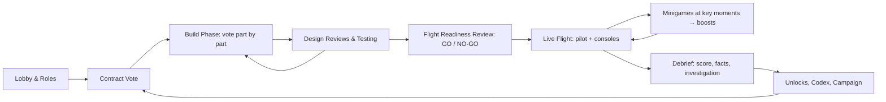
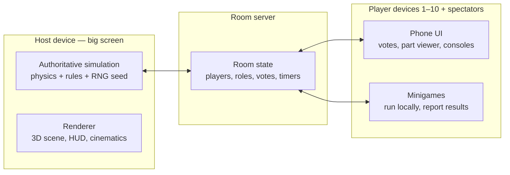

# MissionForge — Full Game Design Document

> **Status:** Proposed concept, full-scope design (not an MVP cut). Draft v1.0, 2026-11-14.
> **Challenge:** NASA Space Apps 2026 — *Space Mission Design Game*.
> MissionForge is our team's proposed concept. It is not an official NASA game specification, and the engine and final scope are still team decisions.
> **Numbers:** Every number is tagged as a **physical model** (real physics/constants), **real-world approximate** (rounded from real hardware), or **game value** (a balancing placeholder). See [§19 Numeric Assumptions Register](#19-numeric-assumptions-register). Facts must be verified against a cited source before release (see [§12.4](#124-fact-bank-draft--verify-before-release)).

---

## Table of Contents

1. [Vision & Pillars](#1-vision--pillars)
2. [Core Loop & Session Structure](#2-core-loop--session-structure)
3. [Players, Sessions & Roles](#3-players-sessions--roles)
4. [The Voting System](#4-the-voting-system)
5. [Mission Contracts](#5-mission-contracts)
6. [Build Phase Systems](#6-build-phase-systems)
7. [Parts Catalog](#7-parts-catalog)
8. [Physics & Simulation Model](#8-physics--simulation-model)
9. [Flight Phases, Controls & Mission Control](#9-flight-phases-controls--mission-control)
10. [Minigames](#10-minigames)
11. [Boosts, Effects & Scoring](#11-boosts-effects--scoring)
12. [Education & Facts System](#12-education--facts-system)
13. [Game Modes & Progression](#13-game-modes--progression)
14. [UX & Screens](#14-ux--screens)
15. [Audio, Visual & Haptic Direction](#15-audio-visual--haptic-direction)
16. [Accessibility & Inclusivity](#16-accessibility--inclusivity)
17. [Technical Architecture](#17-technical-architecture)
18. [Balancing](#18-balancing)
19. [Numeric Assumptions Register](#19-numeric-assumptions-register)
20. [NASA Space Apps Alignment](#20-nasa-space-apps-alignment)
21. [Glossary](#21-glossary)
22. [Open Questions & Team Decisions](#22-open-questions--team-decisions)
23. [Appendix A — Example Session Walkthrough](#appendix-a--example-session-walkthrough)

---

## 1. Vision & Pillars

### 1.1 Elevator pitch

**MissionForge** is a cooperative party game for 1–10 players. The group acts as a space agency's mission team. They accept a mission contract and vote on every part of the rocket and spacecraft while working within a **money** and **time** budget. They then fly the whole mission live: countdown, launch, Max Q, staging, orbit, operations, deorbit, reentry and landing. One player flies with game controls. Everyone else staffs Mission Control consoles on their phones and jumps into **group minigames** at critical moments. Successful minigames give boosts that make the flight better, more cinematic and higher-scoring. Failed minigames never block progress. Real spaceflight facts are part of the mechanics, so players learn by doing rather than by reading.

### 1.2 Design pillars

| # | Pillar | What it means in practice |
|---|---|---|
| P1 | **Every choice is a trade-off** | No part is strictly best. Each part shows stats *and* drawbacks before the vote. Mass, cost, schedule, reliability, power and data are always in tension. |
| P2 | **Everyone has a seat in Mission Control** | All players vote, all players have a role, all players join minigames. No one waits idle. |
| P3 | **Learn by doing** | Facts sit inside mechanics: the rocket equation is a puzzle, Max Q is a throttle challenge, reentry blackout is a real loss of signal. |
| P4 | **Fail forward** | Failures are explained, never arbitrary. A failed minigame only means no boost. A failed mission produces an investigation and a lesson for the next attempt. |
| P5 | **Real physics, honest simplifications** | The flight model uses real equations. Where we simplify (2D flight, game-scaled costs), the game says so. |
| P6 | **Readable at a glance** | Shared big screen plus personal phone screens. Every number has a unit, a color and a "what this means" tooltip. |

### 1.3 Target audience

- **Primary:** students aged 12–18, classrooms, families, clubs and hackathon judges.
- **Secondary:** space enthusiasts and casual party-game groups.
- **Session length:** Quick Mission is 25–40 min. Campaign missions are 30–60 min each.
- **Players:** 1–10 on one session. Optional spectators/audience are unlimited (see [§13.7](#137-spectator--audience-mode)).

### 1.4 Platforms

- **Host screen:** desktop/laptop browser or TV via laptop. It runs the simulation and the main visuals.
- **Player devices:** any phone, tablet or laptop browser. Players join with a room code or QR code, with no install and no account.
- **Controllers:** keyboard/mouse, gamepad (standard mapping) or touch for the pilot.

---

## 2. Core Loop & Session Structure

### 2.1 Core loop



### 2.2 Session timeline (Quick Mission, game values)

| Segment | Duration | What happens |
|---|---|---|
| Lobby | 1–3 min | Join by code/QR, choose nickname & avatar, roles assigned |
| Mission briefing | 1 min | Animated briefing by CAPCOM; contract objectives and constraints |
| Contract vote | 1 min | Vote between 2–3 offered contracts (or host locks one) |
| Build phase | 10–15 min | 14–20 part votes at ~45 s each, with tests, anomaly cards and reviews |
| Flight Readiness Review | 1 min | Final GO/NO-GO poll |
| Flight | 8–14 min | Countdown → landing, with 6–10 minigames |
| Debrief | 2–4 min | Score, timeline, investigation, facts collected, awards |

### 2.3 Mapping to the real NASA project lifecycle

MissionForge's phases follow NASA's project lifecycle (NASA Systems Engineering Handbook) so players experience the real process:

| NASA lifecycle phase | MissionForge equivalent | Gate / review in game |
|---|---|---|
| Pre-Phase A — Concept Studies | Contract vote, mission briefing | Mission Concept Review (auto) |
| Phase A — Concept & Technology Development | Launch site, payload configuration votes | System Requirements Review (requirements checklist appears) |
| Phase B — Preliminary Design | Stage & propulsion votes | **PDR** — Preliminary Design Review |
| Phase C — Final Design & Fabrication | Avionics, GNC, comms, power, TPS, recovery votes | **CDR** — Critical Design Review |
| Phase D — Assembly, Integration, Test & Launch | Testing campaign, integration, rollout, countdown, launch | **FRR** — Flight Readiness Review (GO/NO-GO) |
| Phase E — Operations & Sustainment | Orbit ops, reentry, landing | Real-time ops |
| Phase F — Closeout | Debrief and investigation | Lessons Learned card |

---

## 3. Players, Sessions & Roles

### 3.1 Joining a session

1. The host opens MissionForge on the big screen and clicks **New Mission**. A 4-letter room code and a QR code appear.
2. Players open the join page, enter the code (or scan) and pick a nickname (filtered list or free text with profanity filter) and an avatar (astronaut suit color + patch).
3. No accounts are needed and no personal data is collected (see [§17.9](#179-privacy--safety)).
4. Players can join until the Build Phase starts. Late joiners after that become **spectators** until the next vote round, then join as full voters.
5. Disconnected players keep their slot and role for 3 minutes. Their votes count as abstentions while away.

### 3.2 Player-count scaling

| Players | Roles per player | Voting | Minigames | Notes |
|---|---|---|---|---|
| 1 (Solo) | All roles | Direct choice (no vote) | Solo performance tiers ([§10.3](#103-completion-tiers--boost-scaling)) | AI "Flight Director" gives hints |
| 2 | 5 each | Ties broken by Flight Director role | Fraction-based tiers | |
| 3–4 | 2–3 each | Plurality | Fraction-based | Recommended minimum for full party feel |
| 5–7 | 1–2 each | Plurality / optional runoff | Fraction-based | |
| 8–10 | 1 each | Plurality / optional runoff | Fraction-based | Every console staffed |

### 3.3 Mission Control roles

Roles are named after real Mission Control console positions. Each role gives **Insight** (extra information in its area), a **Console** during flight, and a **once-per-mission ability**.

| Role | Real-world origin | Insight during Build | Flight console | Once-per-mission ability |
|---|---|---|---|---|
| **FLIGHT** — Flight Director | Leads Mission Control; final GO/NO-GO | Sees full readiness summary & warnings first | Overall status board; calls polls | **"Decision Time"**: ends a stalled vote immediately; breaks ties |
| **BOOSTER** — Launch vehicle propulsion | Apollo-era BOOSTER console | Engine reliability ranges, throttle ranges | Chamber pressure, engine health, propellant levels | **Hot-Fire Discount**: next engine test costs 50% less |
| **STRUCT** — Structures & materials | Structural engineering teams | Dry-mass breakdown, load margins | Structural load (Max Q), vibration | **Reinforce**: +10% load margin on one stage |
| **GUIDO** — Guidance | Apollo GUIDO console | Navigation accuracy, sensor drift | Trajectory error vs. ideal path | **Course Correct**: halves insertion error once |
| **FIDO** — Flight dynamics | FIDO console (trajectory) | Δv requirement breakdown, orbit targets | Apoapsis/periapsis, launch window clock | **Window Extension**: +5 min launch window once |
| **EECOM** — Power, thermal & life support | Apollo EECOM console | Power budget, battery, thermal margins | Power/battery %, temperatures, cabin | **Load Shed**: emergency power save that prevents one brownout |
| **INCO** — Communications | INCO console | Data rates, ground station coverage | Signal strength, data downlinked, ground passes | **Priority Pass**: doubles data from one ground pass |
| **PAYLOAD** — Payload & science | Payload officers | Instrument performance, science value | Science targets, payload health | **Golden Hour**: one science capture counts ×2 |
| **RETRO** — Reentry & recovery | Apollo RETRO console | Heat shield ratings, entry corridor | Entry angle, heat load, landing ellipse | **Recovery Fleet**: shrinks landing ellipse; guaranteed recovery |
| **PM** — Program manager | Program management | True cost/schedule critical path, budget forecasts | Budget & schedule ledger, score tracker | **Emergency Funding**: +10% budget once (costs reputation in Campaign) |

**Role assignment options (host setting):** random (default), player pick (first come), or vote. Roles rotate between missions in Campaign mode.

**Role merging for fewer players (default order):**
FLIGHT+PM → BOOSTER+STRUCT → GUIDO+FIDO → EECOM+INCO → PAYLOAD+RETRO.

### 3.4 Communication between players

- **No free-text chat** (for child safety). Instead there are **quick pings** shown on the host screen next to the player's avatar:
  "Too expensive!", "Too heavy!", "I like this one", "Check the drawback!", "Need more Δv", "Test it first", "Trust me", "Agreed", plus emoji reactions (🚀 👍 😬 🔥 🤔).
- **Role tags:** a role-holder can put a **Recommended** or **Concern** badge on any option in their area. The badge is visible to all.
- **Voice:** players in the same room just talk. Remote groups can use their own voice chat. The game is designed for talking.

---

## 4. The Voting System

### 4.1 Vote round flow

Each part selection is one **vote round**:

| Step | Duration (game value) | What players see |
|---|---|---|
| 1. **Reveal** | 3 s | Category name and why it matters (one sentence + icon). Options fly in on the host screen. |
| 2. **Inspect** | 15–30 s | Every device shows every option as a **Part Card** ([§14.3](#143-part-card-specification)) with a rotatable 3D model, stats, **drawbacks**, real-world twin and an "if chosen" preview of the rocket and dashboard. |
| 3. **Insight & Pitch** | runs alongside Inspect | The role-holder sees extra info and may tag Recommended/Concern. Pings flow. |
| 4. **Predict** (optional, ~1 in 3 rounds) | 8 s | A quick question tied to the options, e.g. "Which engine is most efficient in vacuum?" Correct answers earn Knowledge Points (KP). |
| 5. **Vote** | 15–20 s (configurable 10–60 s) | Tap an option. Votes can be changed until the timer ends. Live tallies are shown (setting: open or hidden). |
| 6. **Result** | 3 s | The winning part animates onto the rocket. The dashboard updates with deltas (green/red). |
| 7. **Commit** | instant | Budget and schedule are deducted. The Codex entry for that part unlocks. |

### 4.2 Rules

- **Winner:** the option with the most votes (plurality, which is a majority in 2-option rounds).
- **Strict majority (optional setting):** if no option has more than 50%, a 10 s **runoff** between the top two follows.
- **Tie-breakers (in order):**
  1. FLIGHT's vote decides, if FLIGHT voted for one of the tied options.
  2. **Trivia sudden-death:** a single fact question; the first correct answer picks among the tied options.
  3. Seeded random draw, shown visibly as a coin flip animation.
- **Abstain:** a player who doesn't vote is counted as abstaining. If everyone abstains, the **role-holder's** Recommended option wins; otherwise the cheapest valid option wins.
- **Veto token:** each player has **one veto per mission**. Using it removes one option *before* voting closes (shown dramatically: "VETO — PROP"). An option can only be vetoed once, and at least two options must remain.
- **Affordability:** options that would exceed the remaining budget or schedule are shown with a red **"Over budget by $X M"** banner. They can be voted for only if PM's Emergency Funding is still available; choosing one triggers it.
- **Invalid combos:** options that would make the rocket unflyable (e.g. lift-off TWR < 1) remain visible with a **"Will not fly"** warning so players learn why, but they cannot win unless a later vote can fix it (the game checks that a fix exists).
- **Quick votes:** non-part decisions (anomaly responses, test or skip, launch GO/NO-GO, abort or continue) use 10 s two-option votes.
- **Solo play:** no vote. The player picks directly, and the AI Flight Director offers a hint with a reason.

### 4.3 Vote-driven decisions beyond parts

- Contract selection
- Whether to run each optional test ([§6.6](#66-testing-campaign))
- Responses to anomaly cards ([§6.8](#68-anomaly-cards-build-phase-events))
- Design review outcomes (pass / rework)
- **GO/NO-GO** at the Flight Readiness Review and before launch (the polling ritual: FLIGHT calls each console, and each player answers GO or NO-GO on their device)
- In-flight: abort or continue, burn now or wait, skip entry or direct entry (lunar contract)
- Mission patch design ([§13.4](#134-cosmetics--mission-patches))

---

## 5. Mission Contracts

Contracts set the target, payload, requirements, budget and schedule. The best rocket differs per contract.

### 5.1 Contract overview

| ID | Contract | Destination | Payload (game value) | Δv needed from pad¹ | Budget² | Schedule² | Special rules | Inspired by |
|---|---|---|---|---|---|---|---|---|
| C0 | **First Light** (tutorial) | Suborbital, ≥100 km apogee | 0.1 t science package | ~2.0 km/s | $25 M | 60 days | Parachute recovery required | Sounding rockets |
| C1 | **Earth Watch** | Sun-synchronous orbit, 550 km, ~97.6° | 150 kg Earth-observation smallsat (designed by the team) | ~9.7 km/s | $90 M | 180 days | Payload Bay design sub-phase; science scoring | Landsat-type missions, CubeSats |
| C2 | **Constellation Courier** | LEO 500 km, 53° | 3 × 400 kg comm sats | ~9.5 km/s | $120 M | 200 days | Upper stage must restart 3×; deploy each | Satellite constellations |
| C3 | **Station Resupply** | Space station orbit, 420 km, 51.6° | 6 t cargo capsule | ~9.6 km/s + 0.3 km/s capsule | $250 M | 240 days | Short launch window; rendezvous + docking; capsule returns cargo | Cargo resupply missions |
| C4 | **Crew Flight** | LEO 400 km, 3 days | 8 t crew capsule, 4 crew | ~9.5 km/s | $400 M | 300 days | Launch escape system required; crew safety outweighs all other scores | Crewed capsule missions |
| C5 | **High Relay** | Geostationary transfer orbit | 4 t comm sat | ~11.9 km/s | $220 M | 260 days | Long coast: boil-off and restarts matter | GEO comm sats |
| C6 | **Lunar Loop** | Lunar flyby & return | 10 t capsule | ~12.6 km/s | $700 M | 360 days | Reentry at ~11 km/s; optional skip entry | Apollo 8, Artemis I |
| C7 | **Red Landing** | Mars surface | 1 t lander in aeroshell | ~13 km/s (to Mars transfer) | $600 M | 400 days | Launch window about every 26 months; EDL with signal delay | Mars landers |
| C8 | **Comeback Kid** | LEO 300 km | 10 t, **plus** booster must land | ~9.4 km/s + landing reserve | $150 M | 200 days | Booster recovery heavily scored | Reusable boosters |

¹ Real-world approximate values including gravity and drag losses. See [§19](#19-numeric-assumptions-register).
² Game values (budget in "$M game-scaled", not real prices).

### 5.2 Objective structure (every contract)

- **Primary objective:** required for mission success (e.g. payload delivered to orbit within tolerance).
- **Secondary objectives (2–3):** bonus points (e.g. under budget, booster landed, ≥80% science captured).
- **Stretch objective (1):** hard bonus (e.g. "Gold on every minigame", "Land within 1 km of target").
- **Safety objective (crewed contracts):** crew returns safely. If the crew is lost, the mission grade is capped at D regardless of other scores, and the debrief handles this respectfully ([§12.1](#121-principles)).

### 5.3 Contract detail examples

**C1 Earth Watch**: the team designs an Earth-observation satellite (continuing the original MissionForge CubeSat concept), then the rocket that launches it.
- Primary: reach SSO at 550 km ±25 km, inclination within ±0.2°, satellite power-positive.
- Secondary: capture ≥10 science targets; downlink ≥8 GB; finish under budget.
- Stretch: capture all 15 targets (including a hurricane, a wildfire and a glacier).

**C3 Station Resupply**:
- Primary: dock with the station and deliver cargo.
- Secondary: return 1 t of cargo safely; launch on the first attempt (no scrubs).
- Stretch: dock with an approach speed under 0.05 m/s at contact.

**C7 Red Landing**:
- Primary: land the lander safely on Mars.
- Secondary: land inside the target ellipse; send first image within one Mars day.
- Stretch: perfect "Seven Minutes of Terror" sequence ([MG-26](#mg-26-seven-minutes-of-terror)).

---

## 6. Build Phase Systems

### 6.1 Build Bay screen (host)

- **Center:** the live rocket on a launch-pad gantry. It grows piece by piece as votes resolve. During each vote, the **leading option is shown as a translucent ghost** on the rocket.
- **Left:** the **Readiness Dashboard** ([§6.3](#63-readiness-dashboard)).
- **Right:** the current vote with option cards, live tallies, timer, role tags and pings.
- **Bottom:** the **Integration Timeline** (schedule Gantt with critical path) and budget bar.
- **Top:** contract objectives and a phase tracker (A → B/PDR → C/CDR → D/FRR).

### 6.2 Vote order (rockets are designed around the payload)

Rockets are sized from the payload downward: the payload drives the upper stage, which drives the first stage. Vote order follows that logic:

1. Launch site
2. Payload configuration (contract-specific sub-votes, [§7.2](#72-payload-bay-contract-specific))
3. Payload return (capsule contracts: heat shield, recovery)
4. Launch escape system (crewed only)
5. Payload fairing (non-capsule contracts)
6. Upper stage engine
7. Upper stage engine count
8. Upper stage tank size
9. Stage separation system
10. First stage engine
11. First stage engine count
12. First stage tank size
13. Structural material
14. Strap-on boosters
15. Booster recovery
16. Avionics / flight computer
17. Navigation sensors
18. Steering & control (aero + RCS)
19. Power system
20. Communications
21. Mission assurance level

Not every contract uses every vote. **Each vote shows only 3–5 options relevant to the contract** to keep rounds quick.

### 6.3 Readiness Dashboard

All values update live and show a **preview delta** for the leading option during each vote.

| Metric | Formula / source | Type | Display |
|---|---|---|---|
| **Total Δv** | Σ per stage: `Isp_eff · g0 · ln(m_initial / m_final)` | Physical model | Bar vs. contract requirement with margin % |
| **Lift-off TWR** | `F_total_SL / (m_total · g0)` | Physical model | Must be > 1.0; ideal 1.2–1.5 shown in green |
| **Upper stage TWR** | `F_vac / (m_stage_stack · g0)` | Physical model | Warning if < 0.3 (high gravity losses) |
| **Total mass** | Σ part masses + propellant | Physical model | t |
| **Cost** | Σ part costs + tests + launch site fees | Game value | $M of budget |
| **Schedule** | `max(lead times) + Σ integration days + Σ test days` | Game value | Days vs. deadline; critical path highlighted |
| **Est. mission success** | Product of phase reliabilities, shown with ± uncertainty band | Game value | % with error bar |
| **Payload power balance** | Generation − consumption (sunlit/eclipse) | Simplified physical | W, green/red |
| **Data budget** | Data generated vs. downlink capacity per day | Simplified physical | GB/day |
| **Max entry speed rating** | From heat shield | Real-world approximate | km/s vs. contract entry speed |
| **Stability** | Center of pressure aft of center of mass? | Simplified physical | Icon + explanation |

### 6.4 Budget & schedule

- **Budget:** each part has a cost. Tests, launch site fees and anomaly responses also cost money. Leftover budget converts to score (and to carry-over in Campaign).
- **Schedule:** two kinds of time:
  - **Procurement lead time:** parts are ordered in parallel, so only the longest lead time counts.
  - **Integration time:** parts are assembled in sequence, so integration days add up.
  - **Test time:** each test adds days.
  - This teaches the **critical path**: the Integration Timeline highlights the chain that sets the launch date.
- **Missing the deadline:** the launch slips to the next window. Each slip costs reputation and score. For C7 (Mars) a missed window is a 26-month wait, which is mission-ending in Quick Mission and a big campaign setback.
- **Real-time timer:** separately, each vote round has a real-world countdown so sessions keep moving.

### 6.5 Reliability & uncertainty

- Each part has a **true reliability** (hidden) and a **displayed estimate with an uncertainty band**, e.g. "96% ± 4%".
- **Maturity levels** (inspired by NASA's Technology Readiness Levels): new technology starts with a wide band, flight-proven hardware with a narrow one.
- **Testing narrows the band** and can **reveal a hidden flaw**, which the team can fix for time and money.
- **Mission success estimate** = product of every part's reliability across the flight phases in which it is used.
- **Redundancy:** for parallel components, `R_system = 1 − (1 − R)^n` (physical/statistical model).
- **Engine-out capability:** if one engine in a cluster fails and the remaining thrust still gives enough TWR and Δv, the mission continues (see [§7.6](#76-engine-count--clustering)).

### 6.6 Testing campaign

After certain votes, the team can run optional tests (quick vote: Test / Skip).

| Test | Applies to | Cost (game) | Days (game) | Reveals / improves | Real-world basis |
|---|---|---|---|---|---|
| Component qualification | Any part | 5% of part cost | 3 | Narrows uncertainty band 50% | Component qualification testing |
| **Engine hot-fire** | Engines | 10% of engine cost | 7 | Reveals combustion instability / turbopump flaws; +1% reliability | Engine test stands |
| **Static fire** (full stage) | Stages | $2–8 M | 5 | Reveals plumbing leaks, engine-out behavior | Pre-launch static fires |
| **Wet dress rehearsal** | Whole vehicle | $3 M | 4 | Reveals propellant loading & countdown issues; fewer holds | Wet dress rehearsals |
| **Vibration (shake) test** | Payload / avionics | $1–3 M | 4 | Reveals loose components; payload reliability + | Shake-table testing |
| **Thermal-vacuum test** | Payload / spacecraft | $2 M | 6 | Reveals thermal design faults; power & thermal + | Thermal-vacuum chambers |
| **Drop test** | Parachutes | $1.5 M | 5 | Reveals parachute sequencing faults | Parachute drop tests |
| **Arc-jet test** | Heat shield | $2 M | 5 | Reveals TPS weak spots; +heat margin | Arc-jet facilities |
| **Software-in-the-loop** | Avionics / GNC | $1 M | 3 | Reveals software faults (e.g. data overflows) | Simulation testing |
| **Pogo suppression test** | First stage | $1 M | 2 | Removes pogo risk if found | Pogo suppressors |

Testing also triggers build-phase minigames ([MG-03](#mg-03-weld-inspector), [MG-04](#mg-04-orientation-check), [MG-06](#mg-06-shake-table)) whose results improve the test outcome.

### 6.7 Redundancy options

Some categories offer single, dual or triple configurations (avionics, batteries, parachutes, reaction wheels). More redundancy raises reliability but adds mass, cost and integration days. The dashboard shows the effect immediately.

### 6.8 Anomaly cards (build-phase events)

Every 3–5 votes, an **anomaly card** may be drawn (seeded random, weighted by choices). The team votes on a response.

| Card | Trigger weight | Response options (quick vote) |
|---|---|---|
| **Supplier Delay** | Higher for single-source parts | Pay +$4 M to expedite / accept +12 days / switch to alternative part |
| **Budget Cut** ("Congress trims the budget by 10%") | Campaign mode more often | Cut a test / downgrade a part / use Emergency Funding |
| **Test Failure** | After a test reveals a flaw | Fix (+$, +days) / fly as-is (reliability −) / swap part |
| **Weather Front** | Coastal launch sites | Move launch earlier (+$ overtime) / accept possible scrub |
| **Engineering Breakthrough** | Rare, positive | +2% Δv on one engine for free / −5 days |
| **Range Conflict** | Busy launch sites | Pay for priority / slip 5 days |
| **Payload Overweight** | Payload contracts | Remove an instrument / accept less Δv margin / bigger tank vote |
| **Software Bug Found** | Skipped software testing | Patch (+3 days) / fly with workaround (one in-flight alarm minigame guaranteed) |
| **Contamination in Clean Room** | Science payloads | Clean (+$1 M, +2 days, minigame [MG-05](#mg-05-clean-room)) / accept science penalty |
| **Key Engineer Sick** | Random | Overtime (+$) / slip 3 days |
| **Helium Shortage** | Pressure-fed systems | Pay premium / switch pressurant (+mass) |
| **Lightning Season** | Subtropical coast site | Accept scrub risk / add lightning-protection checks (+$1 M) |

### 6.9 Design reviews

- **PDR** (after propulsion votes), **CDR** (after subsystem votes) and **FRR** (before launch).
- The game runs automatic checks and lists issues by severity: **Blocker** (can't fly), **Major** (high risk), **Minor**.
- The team votes **Pass** or **Rework**. Rework reopens one chosen category for a re-vote at the cost of +days and a re-integration fee (game value: 30% of the replaced part's cost).
- At FRR, FLIGHT runs the GO/NO-GO poll. Any NO-GO opens a quick discussion (15 s), then a re-poll. Two NO-GO rounds automatically trigger a Rework option.

### 6.10 Rocket preview

- **Live assembly:** each chosen part animates into place (cranes, technicians, sparks).
- **Ghost preview:** during votes, each player's device shows the rocket *with the option they are inspecting*. The host shows the currently leading option.
- **Compare mode:** split view of two candidate builds, showing stat differences.
- **Exploded view:** separates the stages to show internal tanks, engines and payload.
- **Scale reference:** human silhouette, a 10-story building, and the Saturn V (110.6 m) as a ghost outline.
- **Stability indicator:** center of mass (CoM) and center of pressure (CoP) markers, with an explanation of why CoP should sit aft of CoM.
- **Livery:** after the build, the team votes on paint color and mission patch (cosmetic).
- **Phone AR view (optional):** WebXR "place the rocket in your room" on supported devices.

### 6.11 Validation rules

| Rule | Severity | Explanation shown |
|---|---|---|
| Lift-off TWR ≤ 1.0 | Blocker | "Thrust must exceed weight or the rocket won't leave the pad." |
| Total Δv < requirement | Blocker (unless margin within 3% → Major) | "Not enough Δv to reach the target orbit." |
| Crewed contract without launch escape | Blocker | "Crewed vehicles need a way to escape a failing rocket." |
| Returning payload without heat shield | Blocker | "Reentry heating would destroy the vehicle." |
| Heat shield rating < contract entry speed | Major | "Shield not rated for this entry speed." |
| Payload doesn't fit fairing | Blocker | "Payload diameter exceeds fairing." |
| Power negative in eclipse | Major | "Batteries will drain during Earth's shadow." |
| Upper stage restarts < required burns | Blocker | "This mission needs N engine starts." |
| Hydrolox upper + long coast without boil-off mitigation | Major | "Liquid hydrogen boils off during long coasts." |
| Data generated > downlink capacity | Minor | "You'll collect more data than you can send home." |

---

## 7. Parts Catalog

### 7.0 Stat legend & units

| Stat | Unit | Notes |
|---|---|---|
| Mass | t (tonnes) or kg | Dry mass unless noted |
| Thrust | kN | SL = sea level, Vac = vacuum |
| Isp | s | Specific impulse: how efficiently an engine uses propellant. Higher means more Δv per kg of propellant. |
| Cost | $M | **Game-scaled**, not real prices |
| Lead | days | Procurement lead time (parallel) |
| Integ. | days | Integration time (serial) |
| Rel. | % | Displayed base reliability per flight (hidden true value within band) |
| Maturity | Proven / Mature / New | Sets the uncertainty band: ±1% / ±3% / ±6% |

Engine thrust and Isp values are **real-world approximate**, rounded from the real hardware class named in "Twin". Cost, lead, integration and reliability are **game values**. Real-world twins are cited for education. In-game part names are generic, inspired by real hardware.

Every Part Card shows **Strengths**, **Drawbacks** (red, always visible), **Hidden risk indicator** (if maturity is not Proven), **Real-world twin** and a **Did you know?** fact.

---

### 7.1 Launch site

Earth's rotation gives a free eastward speed boost of about `465 m/s × cos(latitude)` (physical model).

| Option | Latitude | Eastward boost | Strengths | Drawbacks | Cost | Lead | Twin |
|---|---|---|---|---|---|---|---|
| **Equatorial Spaceport** | ~5°N | ~463 m/s | Biggest rotation boost; reaches any inclination ≥ 5° efficiently | Remote logistics: +$10 M, +20 days; tropical storm anomaly cards | $18 M | 20 | Guiana Space Centre (Kourou, 5.2°N) |
| **Subtropical Coast** | ~28.5°N | ~409 m/s | Balanced; ocean to the east for safe drops | Lightning & weather scrubs; busy range (Range Conflict cards) | $10 M | 5 | Kennedy Space Center / Cape Canaveral |
| **West Coast Polar Range** | ~34.7°N | ~382 m/s | Best for polar & sun-synchronous orbits (launch south over ocean) | Can't launch east over land; fog delays | $9 M | 5 | Vandenberg |
| **Inland Steppe Cosmodrome** | ~46°N | ~323 m/s | Cheap, huge site, fast integration | Spent stages fall on land (recovery zones, +$ range fee); minimum inclination ~46° (station-orbit fact: 51.6°) | $6 M | 3 | Baikonur |

**Did you know?** The International Space Station orbits at 51.6° inclination partly so that launches from Baikonur could reach it.

---

### 7.2 Payload Bay (contract-specific)

#### 7.2.1 Satellite contracts (C1, C2, C5): the spacecraft itself

**Instrument** (C1 Earth Watch)

| Option | Mass | Power | Data / day | Science value | Cost | Drawbacks | Twin / fact |
|---|---|---|---|---|---|---|---|
| Wide-field optical camera | 8 kg | 15 W | 4 GB | ★★ | $3 M | Can't see through clouds or at night | Many CubeSat imagers |
| Multispectral imager | 15 kg | 30 W | 10 GB | ★★★★ | $8 M | High data volume needs a strong radio | Landsat-type sensors (Landsat since 1972) |
| Thermal infrared camera | 18 kg | 40 W, needs cooling | 6 GB | ★★★ (wildfires, ice) | $10 M | Detector must be kept cold (thermal penalty) | Thermal IR instruments |
| Synthetic aperture radar (SAR) | 45 kg | 300 W during imaging | 25 GB | ★★★★★ (sees through clouds, at night) | $20 M | Huge power & data demand; heavy | Radar Earth-observation satellites |

**Satellite power**

| Option | Mass | Generation | Drawbacks |
|---|---|---|---|
| Body-mounted solar cells | 3 kg | 40 W avg | Low power; can't support SAR |
| Deployable solar wings | 9 kg | 150 W avg | Deployment can fail (minigame [MG-15](#mg-15-solar-wing-deploy)) |
| Large deployable array + big battery | 20 kg | 400 W avg | Heavy, expensive, extra integration days |

**Attitude control (pointing)**

| Option | Pointing accuracy | Mass | Drawbacks |
|---|---|---|---|
| Magnetorquers only | ~5° | 1 kg | Too imprecise for high-res imaging; slow |
| Reaction wheels | ~0.1° | 6 kg | Wheels can saturate and need desaturation |
| Reaction wheels + star tracker | ~0.01° | 9 kg | Expensive; star tracker blinded by Sun near bright angles |

Communications and power-storage choices for the satellite reuse [§7.16](#716-power-system-upper-stage--spacecraft--capsule) and [§7.17](#717-communications).

#### 7.2.2 Capsule contracts (C3, C4, C6)

| Option | Mass | Capacity | Strengths | Drawbacks |
|---|---|---|---|---|
| Compact capsule | 6 t | 2 crew or 3 t cargo | Light, cheap | Limited cargo; cramped (crew morale −) |
| Standard capsule | 9 t | 4 crew or 6 t cargo | Balanced | Needs bigger rocket |
| Deep-space capsule | 10 t + 15 t service module | 4 crew, 21 days | Lunar-rated life support | Heavy; requires heavy-lift build |

**Life support (crewed):** open-loop (simple, heavy for long trips) vs. regenerative CO₂ removal (lighter on long missions, more failure modes, enables [MG-19](#mg-19-scrubber-fix)).

#### 7.2.3 Mars lander (C7)

| Option | Landing method | Mass | Strengths | Drawbacks | Twin |
|---|---|---|---|---|---|
| Airbag lander | Parachute + retro + airbags | 0.6 t | Simple, proven for small landers | Small payload; bouncy landing | Mars Pathfinder, Spirit/Opportunity |
| Legged lander | Parachute + throttled engines | 0.8 t | Precise | Engine-plume dust; more steps | Phoenix, InSight |
| Sky crane | Parachute + descent stage lowers rover on cables | 1.0 t | Lands heavy rovers precisely | Most complex sequence | Curiosity, Perseverance |

---

### 7.3 Payload return: heat shield (TPS)

| Option | Max entry speed rating | Mass (per 9 t capsule) | Reusable | Strengths | Drawbacks | Cost | Twin |
|---|---|---|---|---|---|---|---|
| **AVCOAT ablator** | ~11+ km/s (lunar return) | 1.4 t | No | Proven for lunar return; very robust | Heavy; single use; long manufacture (+15 lead days) | $12 M | Apollo, Orion |
| **PICA ablator** | ~12+ km/s | 0.9 t | Partially | Lightweight, high performance | More brittle; arc-jet test recommended | $10 M | Stardust (fastest return at ~12.9 km/s), Mars rovers; PICA-X on Dragon |
| **Reusable ceramic tiles** | ~8 km/s (LEO only) | 1.1 t | Yes | Reuse cuts campaign costs | Fragile; inspection days after each flight; not lunar-rated | $16 M | Space Shuttle tiles |
| **Inflatable decelerator (HIAD)** | ~8 km/s | 0.5 t | Partially | Packs small, huge drag area | New tech (wide uncertainty) | $8 M | NASA LOFTID test (2022) |

---

### 7.4 Launch escape system (crewed only)

| Option | Mass | Abort envelope | Strengths | Drawbacks | Twin |
|---|---|---|---|---|---|
| **Escape tower (tractor)** | 7 t (jettisoned after ~2.5 min) | Pad → upper atmosphere | Proven, mass dropped early | Dead weight during early ascent; can't help after jettison | Apollo LES, Orion LAS |
| **Integrated pusher engines** | 1.5 t carried all flight | Pad → orbit | Always available; enables propulsive landing upgrades | Heavier through the whole flight; complex | Crew Dragon SuperDracos |
| **Ejection seats** | 0.4 t | Pad & low altitude only | Cheap, light | Very limited envelope; crew safety score capped | Gemini |

**Did you know?** In 2018, a Soyuz crew survived a booster failure because the launch escape system pulled their capsule away safely.

---

### 7.5 Payload fairing

| Option | Diameter | Mass | Strengths | Drawbacks | Cost | Twin / fact |
|---|---|---|---|---|---|---|
| Small fairing | 1.5 m | 0.4 t | Light, cheap | Only small payloads | $2 M | Small launchers |
| Standard fairing | 4 m | 1.5 t | Fits most payloads | Heavier | $5 M | Medium-lift rockets |
| Large fairing | 5.4 m | 2.4 t | Fits large satellites & stacked constellations | Heaviest | $9 M | Heavy-lift rockets |
| Reusable large fairing | 5.4 m | 2.6 t | 60% refund if recovered ([MG-10](#mg-10-fairing-catch)) | Highest initial cost | $14 M | Recovered fairing halves |

Fairing separation is a failure point. Two NASA climate satellites (OCO in 2009, Glory in 2011) were lost when their fairings didn't separate.

---

### 7.6 Engine count & clustering

| Option (first stage) | Engine-out capable? | Reliability modifier | Integration | Drawbacks |
|---|---|---|---|---|
| 1 engine | No | +0 | Fast | Single point of failure |
| 3 engines | Partial (if TWR allows) | −0.3% complexity, engine-out bonus | +3 days | More plumbing |
| 5 engines | Yes, usually | −0.6%, engine-out bonus | +5 days | Heavier thrust structure |
| 9 engines | Yes | −1.0%, strong engine-out bonus | +8 days | Complex; more parts to test |

Upper-stage options: 1 or 2 engines. More engines means more chances that one fails, but a cluster can survive losing one. The Soviet N1 rocket had 30 first-stage engines and failed on all four launch attempts, partly because of that complexity.

---

### 7.7 First-stage engines

| Option | Propellant | Thrust SL / Vac (kN) | Isp SL / Vac (s) | Mass | Throttle | Restarts | Cost | Lead / Integ. | Rel. / Maturity | Twin |
|---|---|---|---|---|---|---|---|---|---|---|
| **Kerolox Workhorse** | RP-1 / LOX | 850 / 930 | 282 / 311 | 0.47 t | 40–100% | 3 | $1.2 M | 30 / 2 | 98.5% Proven | Merlin 1D |
| **Kerolox Giant** | RP-1 / LOX | 6,770 / 7,770 | 263 / 304 | 8.4 t | Fixed 100% | 0 | $15 M | 90 / 6 | 97% Mature | F-1 (Saturn V) |
| **Kerolox Staged-Combustion** | RP-1 / LOX | 3,830 / 4,150 | 311 / 338 | 5.4 t | 47–100% | 0 | $10 M | 120 / 5 | 98.8% Proven | RD-180 class |
| **Hydrolox High-Efficiency** | LH₂ / LOX | 1,860 / 2,280 | 366 / 452 | 3.5 t | 67–109% | 0 | $40 M | 150 / 6 | 99% Proven | RS-25 |
| **Methalox Full-Flow** | CH₄ / LOX | 2,300 / 2,500 | 327 / 350 | 1.6 t | 40–100% | 5 | $2.5 M | 45 / 3 | 95.5% **New** | Raptor class |
| **Electric-Pump Mini** | RP-1 / LOX | 24 / 26 | 303 / 311 | 0.035 t | 50–100% | 0 | $0.3 M | 20 / 1 | 98% Mature | Rutherford (battery-driven pumps) |

**Drawbacks by option:**
- *Kerolox Workhorse:* lower Isp; soot buildup reduces reuse life.
- *Kerolox Giant:* huge but inefficient; **combustion instability** risk unless hot-fire tested (F-1 engineers set off small bombs inside test engines to make sure instabilities damped out).
- *Staged-Combustion:* single-source supplier, so Supplier Delay cards are more likely.
- *Hydrolox:* best Isp, but liquid hydrogen is very low density, so tanks are huge and heavy. Very expensive. Boil-off.
- *Methalox:* new technology with a wide uncertainty band. Testing strongly recommended.
- *Electric-Pump Mini:* tiny thrust; only for small contracts. Battery mass grows with burn time.

### 7.8 Upper-stage engines

| Option | Propellant | Thrust Vac (kN) | Isp Vac (s) | Mass | Restarts | Cost | Rel. / Maturity | Drawbacks | Twin |
|---|---|---|---|---|---|---|---|---|---|
| **Hydrolox Vacuum** | LH₂ / LOX | 110 | 460 | 0.30 t | 15 | $10 M | 99.3% Proven | Low thrust (gravity losses); boil-off limits long coasts; bulky tanks | RL10 |
| **Kerolox Vacuum** | RP-1 / LOX | 980 | 348 | 0.60 t | 4 | $3 M | 98.5% Proven | Lower Isp | Merlin Vacuum |
| **Methalox Vacuum** | CH₄ / LOX | 2,000 | 375 | 1.6 t | 6 | $4 M | 95.5% **New** | New tech; large nozzle needs a bigger interstage | Raptor Vacuum class |
| **Hypergolic Storable** | Aerozine-50 / N₂O₄ | 90 | 315 | 0.30 t | 50 | $6 M | 99.6% Proven | Toxic propellants (+$2 M ground handling, +3 days); low thrust | AJ10 (Apollo Service Propulsion System) |
| **Solid Kick Motor** | Solid | 68 | 290 | 0.12 t (+2 t propellant fixed) | 0 | $2 M | 99.2% Proven | Can't throttle, shut down or restart; fixed Δv | Star 48 class |

**Did you know?** Hypergolic propellants ignite on contact, with no igniter needed. That made them a good choice for Apollo's engine that *had* to work to bring astronauts home from the Moon.

### 7.9 Tank sizes (per stage)

Propellant capacity (game value, ranges from real rockets):

| Size | First stage propellant | Upper stage propellant | Shown for contracts |
|---|---|---|---|
| XS | 12 t | 2.5 t | C0, C1 small builds |
| S | 120 t | 25 t | C0–C2, C8 |
| M | 280 t | 60 t | C1–C5, C8 |
| L | 420 t | 110 t | C3–C8 |
| XL | 1,000 t | 250 t | C5–C7 |

**Dry tank mass** = propellant mass × structural ratio × material multiplier. Structural ratios (game values from real-world approximate ranges): kerolox 0.05, methalox 0.06, hypergolic 0.06, hydrolox 0.10. Hydrogen is about 16× less dense than LOX (≈71 vs ≈1,141 kg/m³), so hydrolox tanks are much bigger.

### 7.10 Structural material (whole vehicle)

| Option | Dry-mass multiplier | Cost multiplier | Integ. days | Strengths | Drawbacks | Twin / fact |
|---|---|---|---|---|---|---|
| **Aluminum 2219** | 1.00× | 1.0× | +0 | Proven, weldable, cryogenic-friendly | Baseline mass | Saturn V tanks |
| **Aluminum-lithium 2195** | 0.88× | 1.4× | +4 | Lighter, strong | Pricier; trickier welding | Space Shuttle Super Lightweight Tank (1998) |
| **Carbon composite** | 0.75× | 2.2× | +12 | Lightest | Cryogenic leak risk with LH₂ unless tested; expensive | Electron rocket structure; X-33 composite LH₂ tank failure (1999) |
| **Stainless steel** | 1.25× | 0.6× | −5 | Cheap, tough, handles heat and cryogenics; +reuse life | Heaviest | Starship; Atlas "balloon tanks" (so thin they needed pressure to keep their shape) |

### 7.11 Strap-on boosters

| Option | Thrust each SL (kN) | Burn | Mass each | Cost | Strengths | Drawbacks | Twin |
|---|---|---|---|---|---|---|---|
| None | — | — | — | $0 | Simple | Core must lift everything | — |
| 2 × small solid | 1,600 | ~90 s | 49 t | $6 M each | Cheap extra lift-off thrust | Can't throttle or shut down; rough ride (vibration +) | GEM-63 class |
| 4 × small solid | 1,600 | ~90 s | 49 t | $6 M each | Big lift-off boost | More separation events (staging minigame harder) | GEM-63 class |
| 2 × heavy solid | ~12,500 | ~124 s | ~590 t | $40 M each | Massive thrust for lunar/Mars contracts | Very heavy; can't shut down once lit | Space Shuttle / SLS solid rocket boosters |
| 2 × liquid side boosters | = first stage | = first stage | = first stage | 2× first-stage cost | Throttleable; recoverable (dual landing!) | Complex integration (+15 days); reliability −1% | Falcon Heavy style |

### 7.12 Stage separation system

| Option | Rel. | Mass | Strengths | Drawbacks | Fact |
|---|---|---|---|---|---|
| **Pyrotechnic bolts + springs** | 99.5% | 0.2 t | Cheap, proven | Shock loads; needs **ullage** settling before upper ignition | Ullage motors on Saturn V settled propellant to the tank bottom |
| **Pneumatic pushers** | 99.3% | 0.3 t | Gentle, reusable-friendly | Costlier ($1.5 M) | Used on reusable boosters |
| **Hot staging** | 98.5% | 0.6 t (vented interstage) | Upper stage ignites *before* separation: no ullage, less gravity loss (+1.5% Δv) | Risky; heavier interstage | Soyuz upper stages, Titan II, Starship (2023) |

### 7.13 Avionics / flight computer

| Option | Rel. | Mass | Cost | Strengths | Drawbacks | Twin / fact |
|---|---|---|---|---|---|---|
| Commercial computer (single) | 97% | 10 kg | $1 M | Cheap, fast | Radiation upsets (bit flips) on long missions | — |
| Triple-redundant commercial | 99.2% | 30 kg | $3 M | Three computers vote; one can fail | More wiring & integration | Falcon 9 flight computers |
| Radiation-hardened | 99.5% | 15 kg | $8 M | Immune to most radiation upsets; deep-space ready | Slow processor (guidance precision −10%) | RAD750 class (Curiosity, Perseverance; ~200 MHz) |
| Rad-hard + backup | 99.8% | 30 kg | $12 M | Best for crewed & deep space | Heavy & expensive | Crewed spacecraft practice |

### 7.14 Navigation sensors (GNC)

| Option | Insertion error | Cost | Strengths | Drawbacks | Fact |
|---|---|---|---|---|---|
| IMU only | ±25 km | $0.5 M | Self-contained | Drifts over time | Inertial measurement units sense acceleration & rotation |
| IMU + GNSS | ±3 km | $1 M | Very precise in LEO | Less useful far beyond LEO | GPS works in orbit too |
| IMU + GNSS + star tracker | ±1 km, precise attitude | $3 M | Needed for precise pointing & deep space | Blinded near the Sun | Star trackers match star patterns to a catalog |
| + Terrain-relative navigation | Landing ellipse −60% | $6 M | Precision landing (C7, C8) | Mars/landing only; complex | Perseverance used TRN to avoid hazards in 2021 |

### 7.15 Steering & control

**Aerodynamic control**

| Option | Effect | Drawbacks | Fact |
|---|---|---|---|
| Engine gimbal only | Baseline steering | No help during booster return | Engines swivel to steer |
| + Fins | +stability in atmosphere | +drag, +mass | Early rockets relied on fins |
| + Grid fins | Required for propulsive booster return; steer during descent | +mass, $2 M | Falcon 9 titanium grid fins |

**Reaction control system (RCS), used in space**

| Option | Isp | Strengths | Drawbacks |
|---|---|---|---|
| Cold gas (N₂) | ~70 s | Simple, safe, cheap | Weak; limited fuel |
| Monopropellant hydrazine | ~225 s | Good balance | Toxic |
| Bipropellant | ~290 s | Powerful, efficient | Complex, costly |

### 7.16 Power system (upper stage / spacecraft / capsule)

| Option | Strengths | Drawbacks | Best for | Fact |
|---|---|---|---|---|
| Primary batteries only | Simple, light for short flights | Hours of life only | Upper stages, C0 | Many upper stages run on batteries |
| Li-ion + body solar | Cheap, continuous | Low power | Small satellites | — |
| Deployable solar arrays + Li-ion | High power | Deployment risk; eclipse drain (~35 of every ~90 min in LEO) | Most satellites | Sunlight at Earth delivers ~1,361 W/m² |
| Fuel cells (H₂/O₂) | High power for days; produce drinking water | Limited duration; cryogenic reactants | Crewed short missions | Apollo and the Shuttle used fuel cells |
| Radioisotope generator (RTG) | Works anywhere, day or night | Very expensive; +60 days approvals; deep space only | C7 Mars | Curiosity's RTG produced ~110 W at launch |

### 7.17 Communications

| Option | Data rate (game) | Pointing | Strengths | Drawbacks | Fact |
|---|---|---|---|---|---|
| UHF | 0.01 GB/pass | Omni | Cheap, simple | Very low data | Common on CubeSats |
| S-band | 0.2 GB/pass | Omni / wide | Standard telemetry & commands | Medium data | Apollo's Unified S-Band system |
| X-band | 2 GB/pass | Precise | High data | Needs attitude control | Deep Space Network workhorse |
| Ka-band | 8 GB/pass | Very precise | Very high data | **Rain fade** at ground stations | Higher frequencies are absorbed by rain |
| Relay network subscription | Continuous coverage | — | No waiting for ground passes; shorter blackout gaps | $3 M per mission | NASA's TDRS relay satellites (first launched 1983) |
| Laser (optical) comms | 30 GB/pass | Extreme | Highest data | Clouds block it; new tech | NASA LCRD (2021), DSOC on Psyche (2023) |

### 7.18 Booster recovery

| Option | Δv cost | Cost effect | Strengths | Drawbacks | Fact |
|---|---|---|---|---|---|
| Expendable | 0 | — | Max performance | Throw away the booster | Most rockets in history were expendable |
| Parachute + splashdown | −2% | 20% refund (campaign: refurbish) | Simple | Salt water damage | Shuttle solid boosters were recovered from the ocean |
| Propulsive landing on land (RTLS) | −15% (boostback + landing reserve) | 60% refund | Fast reuse | Big performance cost; needs grid fins & legs | Booster landings since 2015 |
| Propulsive landing on drone ship | −8% | 55% refund | Lower performance cost | Weather-dependent; ship cost $1 M | Ocean landing platforms |

Booster landing uses [MG-24](#mg-24-hoverslam): engines can't throttle low enough to hover, so the burn must reach zero velocity exactly at touchdown.

### 7.19 Capsule/payload recovery (returning missions)

| Option | Strengths | Drawbacks | Fact |
|---|---|---|---|
| Parachutes + splashdown | Proven, gentle | Recovery ship needed; salt water | Orion uses 11 parachutes in sequence |
| Parachutes + soft-landing rockets (ground) | Lands on land, fast crew recovery | Rockets must fire at the right height | Soyuz fires small rockets about a meter above the ground |
| Propulsive landing | Precise; reusable | Needs pusher escape engines; new tech | — |

### 7.20 Mission assurance level

| Option | Cost | Days | Effect | Fact |
|---|---|---|---|---|
| "Faster, Cheaper" | −15% total | −10% | Uncertainty bands ×1.5 | NASA's 1990s "Faster, Better, Cheaper" era had big wins (Mars Pathfinder) and losses (Mars Climate Orbiter) |
| Standard | — | — | — | — |
| Class A (high assurance) | +20% | +15% | Uncertainty ×0.5, +1% reliability on all parts | NASA classifies payload risk from A (highest priority) to D |

---

## 8. Physics & Simulation Model

### 8.1 Constants (physical)

| Constant | Value |
|---|---|
| Standard gravity g0 | 9.80665 m/s² |
| Earth μ (GM) | 3.986 × 10¹⁴ m³/s² |
| Earth mean radius | 6,371 km |
| Earth rotation speed at equator | ~465 m/s |
| Sea-level air density ρ0 | 1.225 kg/m³ |
| Atmospheric scale height H | ~8.5 km (game uses single exponential) |
| Kármán line (edge of space) | 100 km |
| Entry interface | ~120 km |
| Mars μ | 4.283 × 10¹³ m³/s² |
| Mars radius | 3,390 km |
| Mars surface density / scale height | ~0.020 kg/m³ / ~11 km |

### 8.2 Equations used

- **Gravity:** `g(r) = μ / r²` (inverse-square, toward planet center).
- **Atmosphere:** `ρ(h) = ρ0 · e^(−h/H)`.
- **Drag:** `D = ½ · ρ · v² · Cd · A`. Cd comes from a Mach lookup table (peaks near Mach 1).
- **Dynamic pressure:** `q = ½ · ρ · v²`. Max Q is the peak of q during ascent.
- **Thrust vs. altitude:** `F(h) = F_vac − (F_vac − F_SL) · p(h)/p0`, with Isp interpolated the same way.
- **Mass flow:** `ṁ = F / (Isp · g0)`.
- **Rocket equation (dashboard):** `Δv = Isp · g0 · ln(m0 / mf)`.
- **Orbital elements (HUD):** vis-viva `v² = μ(2/r − 1/a)` for semi-major axis; apoapsis/periapsis from the state vector.
- **Reentry heating (Sutton–Graves):** `q̇ = k · √(ρ / r_n) · v³`, with k ≈ 1.74 × 10⁻⁴ (SI, Earth). Heat load integrates q̇ over time and is compared to the TPS rating.
- **G-load:** `|a_non-gravitational| / g0`. Crew safety limits apply.
- **Integration:** fixed step 1/120 s with RK4 during powered and atmospheric flight; analytic Kepler propagation during unpowered vacuum coasts (allows time warp).

### 8.3 Game simplifications (always disclosed in the Codex)

| Simplification | Real-world reality | Why |
|---|---|---|
| Flight in a 2D orbital plane (3D visuals) | Real launches are 3D; plane changes cost Δv | Controllable, readable |
| Inclination handled by a launch-azimuth choice + Δv penalty | Spherical trigonometry of launch azimuth | Keep the concept, simplify the math |
| Single exponential atmosphere | Layered atmosphere with temperature profile | Good enough within ~10% |
| Spherical Earth, no J2/oblateness | Earth's bulge perturbs orbits | Negligible for game duration |
| Engine spool-up 0.5 s, no detailed transients | Complex start sequences | Responsiveness |
| No propellant slosh except scripted pogo event | Slosh dynamics matter | Simplicity |
| Costs and schedules are game-scaled | Real costs vary greatly | Balance and fairness |
| Reliability as probability rolls at checkpoints | Real failure physics | Teaching risk, not randomness |
| Time compression in build phase (days are abstract) | Real programs take years | Session length |
| Lunar/Mars transfers simplified to burn + cinematic coast + patched arrival | Patched conics / n-body | Session length |

### 8.4 Failure model

At **checkpoints** (ignition, lift-off, Max Q, staging, fairing separation, each burn, deployment, entry, chute deploy, landing), each relevant part rolls against its true reliability, modified by tests, boosts and conditions. Failures are **deterministic from the session seed** so replays match.

| Failure mode | Cause in build | In-flight effect | Mitigation | Teaching point |
|---|---|---|---|---|
| Engine shutdown | Low-reliability engine, skipped hot-fire | Loss of thrust | Engine-out cluster | Redundancy |
| Combustion instability | Kerolox Giant untested | Engine destroyed | Hot-fire test | Testing culture |
| Pogo oscillation | Long first stage, no pogo test | Heavy vibration; possible engine shutdown | Pogo test, [MG-11](#mg-11-pogo-damper) | Apollo 13's second stage shut down its center engine due to pogo |
| Structural failure | Ignoring Max Q throttle-down, light material | Vehicle breakup | Throttle bucket, [MG-08](#mg-08-max-q-throttle-bucket) | Aerodynamic loads |
| Stage recontact | Weak separation | Damaged upper stage | Separation system choice | Staging physics |
| Fairing stuck | Random, fairing reliability | Can't reach orbit (too heavy) | Reliable fairing, test | OCO & Glory |
| Guidance drift | IMU-only | Wrong orbit | Better sensors, [MG-09](#mg-09-gravity-turn-tracer) | Navigation |
| Radiation bit flip | Commercial computer, long mission | Safe-mode reboot, lost time | Rad-hard / redundancy | Space radiation |
| Software overflow | Skipped software test | Guidance fault | Software-in-the-loop test | Ariane 5 Flight 501 (1996): a number too big for its variable |
| Solar array stuck | Deployable arrays | Power deficit | [MG-15](#mg-15-solar-wing-deploy) | Deployment risk |
| Cryogenic leak | Composite + LH₂ untested | Propellant loss | Testing, material choice | X-33 |
| Heat shield burn-through | Under-rated TPS, steep entry | Loss of vehicle | Rated shield, [MG-22](#mg-22-entry-corridor) | Reentry heating |
| Parachute failure | No drop test | Hard landing | Drop test, [MG-23](#mg-23-parachute-sequence) | Genesis capsule (2004): a sensor installed backwards meant the chutes never opened |
| Range safety termination | Large trajectory deviation | Flight terminated over ocean | Stay in corridor | Flight termination systems protect people on the ground |

### 8.5 Mission success criteria

- **Full success:** primary objective met.
- **Partial success:** wrong orbit but recoverable (e.g. payload uses its own propulsion), or primary met with lost secondary systems.
- **Failure:** primary not met. Triggers the investigation ([§9.9](#99-fail-forward-investigation--lessons-learned)).

---

## 9. Flight Phases, Controls & Mission Control

### 9.1 Flight phases

| # | Phase | Pilot actions | Console duties (others) | Minigames | Possible events | Fact moment |
|---|---|---|---|---|---|---|
| F0 | **Rollout & pad** | Camera only | Weather check (FLIGHT), range status | — | Weather scrub cards | Crawler-transporter moves at ~1.6 km/h |
| F1 | **Propellant loading & countdown** | Hold/resume calls | All consoles monitor | [MG-07](#mg-07-gono-go-poll), [MG-08b](#mg-08b-propellant-loading) | Holds; sensor glitches | White clouds near the pad are condensation around super-cold LOX vents |
| F2 | **Ignition & lift-off** | Throttle-up, release | BOOSTER watches chamber pressure | Ignition timing (part of MG-07) | Engine fails to start → abort on pad | Rockets are held down until engines reach full thrust |
| F3 | **Pitch-over & gravity turn** | Pitch control | GUIDO trajectory error, FIDO apoapsis | [MG-09](#mg-09-gravity-turn-tracer) | Guidance drift | Rockets tilt over gradually so gravity bends the path |
| F4 | **Max Q** | Throttle down/up | STRUCT load meter | [MG-08](#mg-08-max-q-throttle-bucket) | Structural overload | Peak stress about a minute after lift-off |
| F5 | **Booster sep / MECO / staging** | Stage key | BOOSTER, STRUCT | [MG-10a](#mg-10a-staging-timing) | Recontact, pogo, engine-out | Dropping empty stages saves mass |
| F6 | **Fairing jettison** | Jettison key at the right altitude | PAYLOAD, STRUCT | [MG-10](#mg-10-fairing-catch) (if reusable fairing) | Fairing stuck | Fairings protect payloads only while there's air |
| F7 | **Upper stage burn & orbit insertion** | Throttle, pitch, cutoff | FIDO apo/peri, GUIDO | [MG-12](#mg-12-engine-out-rebalance) (if engine-out) | Early cutoff | Orbital speed in LEO is ~7.8 km/s |
| F7b | **Booster return** (parallel track) | **Second pilot** flies booster in split screen | RETRO | [MG-24](#mg-24-hoverslam) | Landing failure (mission continues) | Boostback, entry and landing burns |
| F8 | **Orbital operations** | Attitude, burns (contract-specific) | INCO, EECOM, PAYLOAD | [MG-13](#mg-13-ground-station-pass) to [MG-21](#mg-21-science-capture) | Debris conjunction, alarms, eclipse | Contract-specific facts |
| F9 | **Deorbit burn** | Retrograde burn timing | RETRO, FIDO | [MG-20](#mg-20-deorbit-burn) | Over/under-burn | Slowing down lowers the far side of the orbit |
| F10 | **Entry interface** | Hold heat-shield attitude | RETRO entry angle | [MG-22](#mg-22-entry-corridor) | Skip-out or overheat | The entry corridor is only a few degrees wide |
| F11 | **Plasma blackout & peak heating** | Attitude hold blind | **Phones show static** | [MG-25](#mg-25-reacquire-signal) at end | Blackout longer than expected | Ionized plasma around the capsule blocks radio |
| F12 | **Descent: drogues → mains** | Deploy timing | RETRO | [MG-23](#mg-23-parachute-sequence) | Chute failure (redundancy helps) | Orion's 11-parachute sequence |
| F13 | **Landing / splashdown & recovery** | Final burn / flare | Everyone | [MG-27](#mg-27-recovery-team) | Hard landing | Recovery ships and helicopters |
| F14 | **Debrief** | — | — | — | — | Mission comparison |

### 9.2 Pilot controls

| Action | Keyboard | Gamepad | Touch (host tablet) |
|---|---|---|---|
| Throttle up / down | W / S (Shift/Ctrl fine) | RT / LT | Throttle slider |
| Pitch | A / D | Left stick | Pitch wheel |
| Yaw/roll (RCS, orbit & entry) | Q / E, arrows | Right stick | Two-finger rotate |
| Stage / separate | Space (hold 0.3 s) | A (hold) | Big STAGE button |
| Cut engines | X | B | CUTOFF button |
| Toggle RCS | R | LB | Toggle |
| Attitude hold (prograde, retrograde, heat shield forward) | T to cycle | Y | Mode chips |
| Deploy (fairing, chutes, legs, arrays) | P / G / F | D-pad | Context button |
| Time warp − / + | , / . | D-pad L/R | Warp chips |
| Map view | M | View / Select | Map tab |
| Camera cycle | C | Right stick click | Swipe |
| **Abort** | Hold Backspace 1.5 s | Hold Select + Start | Guarded abort switch |
| Pause (host only) | Esc | Start | ‖ |

### 9.3 Assist levels (difficulty)

| Level | Ascent | Orbit | Entry | Score multiplier |
|---|---|---|---|---|
| **Cadet** | Autopilot gravity turn; pilot handles throttle at Max Q & staging | Auto-circularize with a prompt | Auto attitude; pilot handles chutes | ×0.8 |
| **Engineer** | Guidance cue on the HUD; pilot flies | Maneuver nodes suggested | Corridor shown | ×1.0 |
| **Flight Director** | No cues except raw telemetry | Manual | Manual, corridor hidden | ×1.25 |

### 9.4 Pilot rotation

- Default: the pilot changes **per flight segment** (ascent, orbit, entry, landing), chosen by quick vote or rotation, so more players get to fly.
- **Co-pilot:** a second player can be assigned, who handles staging and deploys on their phone while the pilot flies.
- **Split-screen booster return:** in recovery missions, a second pilot flies the falling booster at the same time.
- **Pass the controls:** host setting that hands control to any phone (phones become virtual gamepads).

### 9.5 Console duty (non-pilot phones)

Each phone shows a **role console** during flight: real telemetry for that role, plus **callout buttons**.

- When a parameter goes out of limits, the role-holder gets a subtle alert. Pressing the matching callout (e.g. **"THROTTLE DOWN — Max Q"**, **"ENGINE 3 OUT"**, **"BATTERY LOW"**) within the window earns a **Good Call** bonus and shows a voice/text callout on the host screen.
- False or late callouts have no penalty, just no bonus.
- Consoles also let roles **request** actions (e.g. INCO requests "point antenna"). The pilot sees requests as HUD prompts.
- Good Calls fill the **Team Sync meter** ([§11.2](#112-team-sync-meter--mission-control-moment)).

### 9.6 Cameras & HUD

- **Cameras:** pad cam, tracking telescope (long lens with heat shimmer), onboard (engine bell, payload), chase, booster cam, map/orbit view, ground station view, Mission Control room view (avatars at consoles celebrating boosts).
- **HUD:** altitude, velocity (surface/orbital), vertical speed, q (kPa), g-load, throttle %, Δv remaining per stage, propellant %, apoapsis/periapsis, inclination, heat load, time (T+), mission phase strip, active boosts icons.
- **No sound in vacuum:** outside the atmosphere, the onboard camera's exterior audio fades to silence and only internal vibration sounds remain (a fact moment).

### 9.7 Time warp rules

- No warp during powered flight, in the atmosphere below 70 km, or during minigames.
- Up to ×1,000 in unpowered orbital coasts. Lunar/Mars transfers use a cinematic coast with fact narration.

### 9.8 Abort modes

| Abort | When | Requirement | Outcome |
|---|---|---|---|
| Pad abort | Before/at lift-off | Escape system | Crew safe, vehicle lost/saved depending |
| Ascent abort | During first-stage flight | Escape system in envelope | Capsule splashes down |
| Abort to orbit (ATO) | Underperformance late in ascent | Enough Δv for a lower orbit | Lower orbit, partial success (Shuttle STS-51F did this in 1985) |
| Return to launch site | Early engine-out, recoverable vehicle | Δv to turn back | Rare and dramatic |
| Early return | In orbit, life support issue | Deorbit Δv | Partial success, crew safe |

Abort calls are quick group votes (5 s) unless the escape system fires automatically on vehicle breakup.

### 9.9 Fail forward: investigation & lessons learned

When a mission fails or a major anomaly occurs:
1. **Replay:** an instant replay of the failure from the best camera, slowed down.
2. **Investigation minigame ([MG-28](#mg-28-root-cause-investigation)):** players look through telemetry clues to find the root cause.
3. **Lessons Learned card:** a permanent bonus for the next attempt (e.g. "Pogo suppressor added: pogo risk removed for free") and a Codex entry with the real-world parallel.
4. **Retry option:** rebuild with the same budget, pre-filled with the previous design, so only the problematic choices need changing.

---

## 10. Minigames

### 10.1 Design rules

1. **Short:** 15–45 s each.
2. **Everyone plays at once**, each on their own device (or cooperatively, sharing tasks).
3. **Failure never fails the step.** The flight continues normally. Success adds a **boost**.
4. **Instructions in one sentence + a 3 s looping demo.** No reading walls.
5. **The fact is the mechanic.** Each minigame teaches one real concept by making the player do it, then shows a 1-line fact on the result screen.
6. **Difficulty scales with the difficulty setting, not player count.**
7. **Sim keeps going:** the host enters **bullet-time** (×0.1 speed) during minigames, so the rocket visibly continues and tension stays high.
8. **Accessible alternatives:** every minigame has a one-button or no-timing mode ([§16](#16-accessibility--inclusivity)).
9. **Fair across devices:** all input is evaluated locally on each device, with small latency allowances.

### 10.2 Minigame types

| Type | Description | Example |
|---|---|---|
| **Parallel solo** | Everyone plays the same challenge individually | Max Q Throttle Bucket |
| **Cooperative split** | The task is divided; each player handles a piece | Parachute Sequence (each player owns a chute) |
| **Relay** | Players act in sequence, passing state | Go/No-Go Poll |
| **Team-sync** | Everyone must act together within a time window | Staging Timing (all tap within 0.3 s) |

### 10.3 Completion tiers & boost scaling

**Completion fraction** `f = players who succeeded / active players in the minigame`. Active means connected and loaded. Disconnected players are excluded.

| Tier | Threshold | Example (3 players) | Example (10 players) | Boost |
|---|---|---|---|---|
| — | f < 0.33 | 0 | 0–3 | Cosmetic sparkle if ≥ 1 success; no stat boost |
| **Bronze** | f ≥ 0.33 | 1 | 4–6 | Small boost |
| **Silver** | f ≥ 0.66 | 2 | 7–9 | Medium boost |
| **Gold** | f = 1.00 | 3 | 10 | Large boost + "EVERYONE MADE IT" cinematic |
| **Platinum** | Gold + every player "perfect" | — | — | Gold boost + Codex badge + extra flourish |

- **Solo:** the player's performance score `s ∈ [0,1]` uses the same thresholds.
- **2 players:** 1 success = 0.5 → Bronze; both = Gold.
- Quality of individual performance adds score points, not extra boost.

### 10.4 Boost catalog

| Boost | Bronze | Silver | Gold | Cap per mission |
|---|---|---|---|---|
| **Δv Bonus** (efficiency) | +1% | +2% | +3% | +8% total |
| **Reliability Shield** | — | Reroll next failure | Negate next failure | 2 shields held |
| **Heat Margin** | +5% TPS capacity | +10% | +15% | +25% |
| **Precision** (insertion/landing error) | −25% | −50% | −80% | −90% |
| **Load Margin** (structural) | +5% | +10% | +15% | +25% |
| **Fuel Saver** (maneuver propellant) | −3% | −6% | −10% | −20% |
| **Data Multiplier** (science/data) | ×1.1 | ×1.25 | ×1.5 | ×2.0 |
| **Budget Refund** | +$1 M | +$2 M | +$4 M | — |
| **Schedule Recovery** (build only) | −1 day | −3 days | −5 days | −15 days |
| **Crew Morale** (crewed) | +5 | +10 | +20 | 100 |
| **Score Multiplier** (segment) | ×1.05 | ×1.1 | ×1.2 | ×1.5 total |

Every success also gives a **visual payoff**: slow-motion camera, Mission Control room cheering with player avatars, particle trails, CAPCOM praise line, and a phone vibration pattern.

### 10.5 Minigame catalog

Each entry: **When**, **Type / time**, **How to play**, **Success**, **Fact in the mechanic**, **Boost**.

---

#### MG-01 Unit Converter Sprint
- **When:** Build, after propulsion votes (PDR).
- **Type / time:** Parallel solo, 25 s.
- **How to play:** Engineering values fly in with mixed units (lbf, N, ft, m, psi, kPa). Swipe each to the matching SI value before it reaches the "upload" line.
- **Success:** ≥ 8 correct, ≤ 1 wrong.
- **Fact:** NASA's Mars Climate Orbiter was lost in 1999 because one team used pound-force seconds while another expected newton-seconds.
- **Boost:** Reliability (removes a hidden "unit error" software fault) → Bronze: uncertainty −20%; Silver: −40%; Gold: Reliability Shield.

#### MG-02 Rocket Equation Balance
- **When:** Build, after tank votes.
- **Type / time:** Parallel solo, 30 s.
- **How to play:** A balance scale: drop propellant blocks on one side and watch the Δv needle. Each block adds less Δv than the one before (logarithm!). Hit the target Δv band with the fewest blocks.
- **Success:** In band with ≤ 1 extra block.
- **Fact:** The Tsiolkovsky rocket equation: more fuel means more mass to push, so returns shrink. That's why rockets have stages.
- **Boost:** Δv Bonus.

#### MG-03 Weld Inspector
- **When:** Build, during structural material integration or static fire test.
- **Type / time:** Parallel solo, 25 s.
- **How to play:** Scan X-ray images of tank welds by sweeping a finger; tap the hidden porosity and cracks. Avoid false alarms.
- **Success:** Find ≥ 80% of defects with ≤ 1 false alarm.
- **Fact:** Large rocket tanks are joined with friction stir welding, which stirs metal together without melting it.
- **Boost:** Load Margin + structural reliability.

#### MG-04 Orientation Check
- **When:** Build, avionics/sensor integration.
- **Type / time:** Parallel solo, 20 s.
- **How to play:** Sensors and connectors appear rotated; spin each to match the drawing. Some drawings are wrong: spot them with a "drawing error" button.
- **Success:** All correct, including catching the drawing error.
- **Fact:** The Genesis sample-return capsule crashed in 2004 because accelerometers were installed backwards, following a drawing error, so its parachutes never deployed.
- **Boost:** Parachute & sensor reliability; Gold gives a Reliability Shield for the descent phase.

#### MG-05 Clean Room
- **When:** Build, science payload integration (or Contamination anomaly).
- **Type / time:** Parallel solo, 20 s.
- **How to play:** Particles drift onto a camera lens and mirror; wipe them with gentle strokes. Wiping too hard scratches.
- **Success:** ≥ 90% clean, no scratches.
- **Fact:** Spacecraft are built in clean rooms, where air is filtered and workers wear "bunny suits", because one fingerprint can ruin an optic.
- **Boost:** Data Multiplier.

#### MG-06 Shake Table
- **When:** Build, vibration test.
- **Type / time:** Cooperative split, 30 s.
- **How to play:** A payload shakes at rising frequencies. Each player controls one damper slider; keep the resonance meter out of the red as frequencies sweep.
- **Success (per player):** Their damper stays in the green ≥ 80% of the time.
- **Fact:** Spacecraft are shaken on vibration tables to make sure they survive the violent ride to orbit.
- **Boost:** Payload reliability + Schedule Recovery.

#### MG-07 Go/No-Go Poll
- **When:** Countdown (F1), plus ignition.
- **Type / time:** Relay, ~5 s per player.
- **How to play:** FLIGHT calls each console in turn. Each player sees 3 readings for their console (e.g. winds aloft, LOX temperature, battery voltage) with the launch-commit limits. Answer GO or NO-GO correctly within 5 s.
- **Success:** Correct call in time.
- **Fact:** Real launches use launch-commit criteria for weather, winds and hardware. Apollo 12 was struck by lightning twice during launch in 1969, which is why lightning rules matter.
- **Boost:** Removes countdown holds; Gold: launch at the optimal second of the window (+Δv saved).

#### MG-08b Propellant Loading
- **When:** F1.
- **Type / time:** Parallel solo, 20 s.
- **How to play:** Keep a tank fill rate in the target band by tapping valves while boil-off vents. Overfill vents propellant; underfill causes a hold.
- **Success:** Tank ≥ 99% at T-0 without overpressure.
- **Fact:** Super-cold propellants boil continuously, so tanks are "topped off" until just before launch.
- **Boost:** Fuel Saver (more propellant actually aboard).

#### MG-08 Max Q Throttle Bucket
- **When:** F4.
- **Type / time:** Parallel solo, 20 s.
- **How to play:** A dynamic-pressure curve rises. Slide your throttle so the vehicle's stress line stays inside a safe band. Too low wastes time against gravity; too high overloads.
- **Success:** In band ≥ 85% of the time.
- **Fact:** Rockets throttle down near Max Q, the point of maximum aerodynamic stress, about a minute after launch.
- **Boost:** Load Margin + small Δv Bonus.

#### MG-09 Gravity Turn Tracer
- **When:** F3.
- **Type / time:** Parallel solo, 25 s.
- **How to play:** Trace the ideal ascent curve with a finger as the trajectory scrolls. The team's average error steers the real rocket.
- **Success:** Average deviation below threshold.
- **Fact:** Rockets don't fly straight up for long. A gravity turn lets gravity bend the path toward horizontal and saves fuel.
- **Boost:** Precision + Δv Bonus.

#### MG-10a Staging Timing
- **When:** F5 (each staging event).
- **Type / time:** Team-sync, 10 s.
- **How to play:** The engine-cutoff light flashes and propellant gauges drain. Everyone taps SEPARATE in the green window just after cutoff, then IGNITE after settling. The tighter the team's timing, the better.
- **Success:** Each player taps inside the window (±0.3 s).
- **Fact:** Staging drops empty tanks and engines so the rest of the rocket doesn't haul dead weight. Propellant must settle before the next engine lights.
- **Boost:** Δv Bonus; Gold also prevents recontact entirely.

#### MG-10 Fairing Catch
- **When:** F6 (reusable fairing only).
- **Type / time:** Cooperative split, 20 s.
- **How to play:** Two fairing halves drift down under parafoils. Players steer recovery boats (in teams) to keep each half over the net.
- **Success:** Your boat stays under its target ≥ 70%.
- **Fact:** Fairings are expensive enough that some companies recover and reuse them.
- **Boost:** Budget Refund (fairing refund up to 60%).

#### MG-11 Pogo Damper
- **When:** F5 (if pogo triggered, chance raised without a pogo test).
- **Type / time:** Team-sync, 15 s.
- **How to play:** The vehicle bounces lengthwise. Tap in counter-rhythm to the oscillation to cancel it. The more players in sync, the faster it dampens.
- **Success:** Each player's taps are opposite in phase to the oscillation for ≥ 70% of beats.
- **Fact:** Pogo is a feedback loop between engine thrust and fuel flow. Apollo 13's second stage shut down an engine because of severe pogo.
- **Boost:** Prevents engine shutdown; Load Margin.

#### MG-12 Engine-Out Rebalance
- **When:** F5/F7 if an engine fails in a cluster.
- **Type / time:** Cooperative split, 20 s.
- **How to play:** Each player controls one remaining engine's throttle/gimbal; balance the thrust around the center of mass to keep the rocket straight.
- **Success:** Your engine keeps the net torque near zero.
- **Fact:** In 2012, a Falcon 9 lost an engine during ascent and still delivered its primary payload, thanks to engine-out capability.
- **Boost:** Recovers lost Δv; Gold restores the planned trajectory.

#### MG-13 Ground Station Pass
- **When:** F8 (each pass).
- **Type / time:** Parallel solo, 20 s.
- **How to play:** A ground station sweeps across the horizon. Keep your antenna reticle on it as it arcs. Packets fill your data bar while locked.
- **Success:** ≥ 75% lock time.
- **Fact:** Satellites can only talk to a ground station when it's in view. NASA's Deep Space Network uses three sites (California, Spain, Australia) about 120° apart so a spacecraft is always in view of one.
- **Boost:** Data Multiplier.

#### MG-14 Debris Dodge
- **When:** F8 (conjunction warning event).
- **Type / time:** Parallel solo, 20 s.
- **How to play:** Debris tracks approach on a radar. Choose the smallest burn direction and duration that clears the collision probability threshold. Overburning wastes fuel.
- **Success:** Safe miss with ≤ 1.2× the minimum Δv.
- **Fact:** The ISS regularly performs debris-avoidance maneuvers. Tens of thousands of debris objects are tracked in Earth orbit.
- **Boost:** Fuel Saver + Reliability Shield (orbit phase).

#### MG-15 Solar Wing Deploy
- **When:** F8 (satellite or capsule with deployable arrays).
- **Type / time:** Cooperative split, 20 s.
- **How to play:** Each player releases one hinge in the correct order shown by a diagram; then everyone rotates the wing to face the Sun as the spacecraft turns.
- **Success:** Your hinge released in order + Sun-pointing ≥ 80%.
- **Fact:** Sunlight near Earth delivers about 1,361 W per square meter; modern cells convert roughly 30% of it.
- **Boost:** Power margin (no brownouts), Data Multiplier.

#### MG-16 Station Docking
- **When:** F8 (C3).
- **Type / time:** Parallel solo, 40 s; the team's best three average sets the result.
- **How to play:** Line up crosshairs using translation thrusters while closing speed must stay under a limit (displayed in cm/s). Inertia is real: things keep moving until you thrust the other way.
- **Success:** Contact with alignment error < 10 cm and speed < 10 cm/s.
- **Fact:** Spacecraft dock at walking-slow speeds, a few centimeters per second, because in space nothing stops on its own (Newton's first law).
- **Boost:** Precision + Score Multiplier; Gold enables the stretch objective.

#### MG-17 Alarm Triage
- **When:** F8 or descent (guaranteed if "Software Bug Found" was accepted).
- **Type / time:** Parallel solo, 20 s.
- **How to play:** Alarm codes flood in. Drag each to IGNORE, MONITOR or ACT according to the role cheat sheet. Program alarms that mean "computer is busy, still working" can be safely continued.
- **Success:** ≥ 85% correct.
- **Fact:** During the Apollo 11 landing, "1202" alarms warned that the computer was overloaded, but its software kept the most important tasks running and the landing continued.
- **Boost:** Reliability Shield + Precision.

#### MG-18 Eclipse Power Juggle
- **When:** F8 (entering Earth's shadow).
- **Type / time:** Parallel solo, 25 s.
- **How to play:** Toggle spacecraft loads (heaters, radio, instrument) on/off to keep the battery above the red line through the eclipse while keeping critical heaters on.
- **Success:** Battery stays above minimum, critical loads always on.
- **Fact:** In low Earth orbit a spacecraft spends about a third of every ~90-minute orbit in Earth's shadow, running on batteries.
- **Boost:** Power margin; Data Multiplier (instrument stayed on longer).

#### MG-19 Scrubber Fix
- **When:** F8 (crewed, life support event).
- **Type / time:** Cooperative split, 35 s.
- **How to play:** CO₂ rising. Players receive random "spare parts" (hose, tape, card, bag, sock) and must collectively assemble an adapter connecting a square filter to a round socket by dragging parts into slots.
- **Success:** The adapter is completed; each player who placed a correct part succeeds.
- **Fact:** On Apollo 13, engineers on the ground invented a way to fit square CO₂ filters into round sockets using items aboard, and the crew built it.
- **Boost:** Crew Morale + Reliability Shield (crew safety).

#### MG-20 Deorbit Burn
- **When:** F9.
- **Type / time:** Parallel solo, 15 s.
- **How to play:** Hold the burn button while the periapsis marker drops; release when it's inside the target band. Team median result sets the real burn.
- **Success:** Periapsis inside the band.
- **Fact:** To come home, a spacecraft fires its engines *backward* to slow down, which lowers its orbit into the atmosphere.
- **Boost:** Precision (landing ellipse) + Fuel Saver.

#### MG-21 Science Capture
- **When:** F8 (C1 and other observation contracts), several times.
- **Type / time:** Parallel solo, 20 s.
- **How to play:** The ground track scrolls over Earth. Frame and snap targets (hurricane, wildfire, glacier, city lights, algae bloom) as they pass, avoiding clouds unless you chose radar.
- **Success:** ≥ 3 good captures.
- **Fact:** Earth-observation satellites like Landsat have photographed Earth's surface continuously since 1972, tracking change over decades.
- **Boost:** Data Multiplier + science objective credit.

#### MG-22 Entry Corridor
- **When:** F10.
- **Type / time:** Parallel solo, 25 s; the team average sets the real flight path angle.
- **How to play:** Keep the capsule's angle icon inside a narrow corridor. Too steep and the heat bar fills; too shallow and the capsule skips back to space.
- **Success:** ≥ 85% of the time inside.
- **Fact:** Returning capsules must hit a narrow "entry corridor". Apollo capsules had to enter within a few degrees.
- **Boost:** Heat Margin + Precision.

#### MG-23 Parachute Sequence
- **When:** F12.
- **Type / time:** Cooperative split, 20 s.
- **How to play:** Each player owns one parachute stage (cover chutes, drogues, pilots, mains; extra players get backups). Deploy yours exactly when the altitude/speed gate lights; deploying early tears the chute, late gives a hard landing.
- **Success:** Your chute opens in its gate.
- **Fact:** Orion uses 11 parachutes in a precise sequence to slow from hundreds of km/h to about 30 km/h for splashdown.
- **Boost:** Softer landing (Crew Morale, recovery refund) + Score Multiplier.

#### MG-24 Hoverslam
- **When:** F7b (booster return) or C8 landing.
- **Type / time:** Parallel solo, 20 s; team median sets the real ignition altitude.
- **How to play:** The booster plummets. Tap IGNITE at the right altitude so velocity reaches zero exactly at the ground. A ghost shows the ideal.
- **Success:** Touchdown speed < 2 m/s.
- **Fact:** Boosters can't throttle down enough to hover, so they light at the last moment and reach zero velocity right at touchdown, a "hoverslam".
- **Boost:** Recovery success + Budget Refund.

#### MG-25 Reacquire Signal
- **When:** End of F11 blackout.
- **Type / time:** Parallel solo, 15 s.
- **How to play:** Phones show static. Turn a tuning dial to find the capsule's beacon frequency by ear/visual waveform, then press LOCK.
- **Success:** Lock within 10 s.
- **Fact:** During reentry, superheated plasma surrounds the capsule and blocks radio. Apollo crews had several minutes of silence.
- **Boost:** Precision (recovery forces dispatched early) + Crew Morale.

#### MG-26 Seven Minutes of Terror
- **When:** C7 Mars entry, descent and landing.
- **Type / time:** Relay (pre-programming), 45 s, then watch.
- **How to play:** Because of the light-time delay, you can't fly it live. Before entry, the team arranges the EDL sequence cards (heat shield → parachute → separate shield → radar → descent engines → sky crane → cut cables) with timing. Each player programs their step, then everyone watches the result arrive.
- **Success:** Your step is correct in order and timing.
- **Fact:** Radio signals take several minutes (between about 4 and 24, depending on planet positions) to travel between Earth and Mars, so landers must land themselves.
- **Boost:** Precision (landing ellipse) + Reliability Shield.

#### MG-27 Recovery Team
- **When:** F13 splashdown.
- **Type / time:** Cooperative split, 20 s.
- **How to play:** Players crew helicopters and boats; find the capsule using a beacon signal and arrive in order: swimmers, flotation collar, ship.
- **Success:** Your unit arrives in the correct order.
- **Fact:** Recovery teams practice for months so they can reach and secure a capsule within minutes of splashdown.
- **Boost:** Crew Morale + recovery refund.

#### MG-28 Root Cause Investigation
- **When:** After a failure or major anomaly (debrief).
- **Type / time:** Cooperative, 45 s.
- **How to play:** Telemetry cards (pressure spike, temperature drop, vibration, software log) are dealt to players. Together, they assemble the chain of evidence that leads to the root cause.
- **Success:** Correct root cause identified.
- **Fact:** Every real failure is followed by an investigation board that finds the root cause so it never happens again.
- **Boost:** Lessons Learned card quality (Gold = permanent free fix + Codex badge).

#### MG-29 Predict the Physics (bonus round)
- **When:** Between phases (loading moments).
- **Type / time:** Parallel solo, 10 s.
- **How to play:** Quick visual predictions: "Which falls faster in a vacuum: a hammer or a feather?" Choose before the animation plays.
- **Success:** Correct prediction.
- **Fact:** On Apollo 15, David Scott dropped a hammer and a feather on the Moon, and they hit the ground together.
- **Boost:** Knowledge Points + small Score Multiplier.

#### MG-30 Mission Patch Design (cosmetic)
- **When:** After CDR.
- **Type / time:** Cooperative, 30 s.
- **How to play:** Each player contributes one patch element (shape, symbol, color, motto from a list). The team votes on the final patch.
- **Success:** Always succeeds (participation).
- **Fact:** NASA crews have designed their own mission patches since the Gemini program.
- **Boost:** Cosmetic only; the patch appears on the rocket and debrief.

---

## 11. Boosts, Effects & Scoring

### 11.1 Stacking rules

- Same-type boosts stack additively up to the cap in [§10.4](#104-boost-catalog).
- Reliability Shields are consumed on use. The UI shows active shields as glowing icons on the HUD.
- Boosts apply **immediately** and visibly (e.g. Δv bar jumps; heat bar shrinks).

### 11.2 Team Sync meter & Mission Control Moment

- Gold +25, Silver +15, Bronze +8, Good Call +3.
- At 100, the team unlocks a **Mission Control Moment**: one of
  - **Perfect Phase:** auto-perfect the next flight phase, or
  - **Save the Mission:** negate one catastrophic failure, or
  - **Golden Window:** double all scores in the next phase.
- The team chooses with a 5 s vote. The moment plays a cinematic: Mission Control erupts, avatars stand up and cheer.

### 11.3 Scoring formula (game values)

```
Mission Score =
    Objective Points          (Primary 3,000 + Secondary up to 1,500 + Stretch 500)
  + Efficiency                (remaining budget % × 1,000 + schedule margin % × 500)
  + Safety & Recovery         (crew safe 1,000; booster recovered 500; capsule recovered 300)
  + Science / Data            (contract-specific, up to 1,500)
  + Teamwork                  (per minigame: Platinum 250, Gold 200, Silver 120, Bronze 60; Good Calls 20 each)
  + Knowledge                 (correct predictions 50 each; trivia tiebreaks 30)
  × Difficulty multiplier     (Cadet 0.8, Engineer 1.0, Flight Director 1.25)
  × Score boosts              (cap ×1.5)
```

### 11.4 Grades & titles

| Grade | Score (game values) | Title |
|---|---|---|
| S | ≥ 9,000 | "Flawless Mission" |
| A | ≥ 7,500 | "Mission Accomplished" |
| B | ≥ 6,000 | "Solid Engineering" |
| C | ≥ 4,000 | "We Learned A Lot" |
| D | < 4,000 or crew lost | "Back to the Drawing Board" |

### 11.5 Individual recognition (positive only)

At debrief, each player receives at least one award. No shaming or last place:
**Best Callout**, **Budget Hawk** (PM, most saved), **Fact Finder** (most predictions right), **Steady Hands** (best pilot precision), **Team Player** (most minigame successes), **Veto Visionary** (vetoed an option that would have failed), **Rocket Scientist** (best rocket equation result), **Calm Under Pressure** (Gold during blackout/abort).

---

## 12. Education & Facts System

### 12.1 Principles

1. **Show, don't tell:** facts are learned through mechanics first, then named in one line.
2. **Right moment:** a fact appears when it matters (Max Q facts at Max Q).
3. **Short:** ≤ 25 words on screen; deeper reading is optional in the Codex.
4. **Sourced:** every fact has a source and a verification status before release.
5. **Respectful:** real tragedies (e.g. Challenger, Columbia, Apollo 1) are never turned into gameplay failures or jokes. They appear only in the Codex and the Lessons Learned section with a respectful tone, focusing on what engineers learned and the people remembered.
6. **Honest about simplifications:** each Codex physics entry says what the game simplifies.

### 12.2 Delivery channels

| Channel | Where | How it teaches |
|---|---|---|
| **Part Cards** | Build votes | Real-world twin + "Did you know?" + drawbacks |
| **Predict-before-vote** | ~1 in 3 votes | Commit to a prediction, then see the stats; earns KP |
| **Minigame mechanics** | Flight & build | The concept *is* the gameplay |
| **CAPCOM radio chatter** | Flight | Voice lines with real-style callouts ("Throttle down for Max Q", "Go at throttle up") |
| **Failure explanations** | On failure | "This happened because…" + real historical parallel |
| **Trivia tiebreakers** | Tied votes | High-stakes fact questions |
| **Myth or Fact swipe** | Loading screens | Swipe left/right; instant feedback ("Myth: there's no gravity on the ISS. Fact: it's ~90% of surface gravity; astronauts float because they're falling around Earth.") |
| **Mission Codex** | Menu | Collectible illustrated entries, unlocked by events and parts |
| **Debrief comparison** | End of mission | "Your rocket vs. a real one": mass, Δv, cost class |
| **Knowledge Points** | Throughout | Spent in the Campaign tech tree, so learning unlocks parts |

### 12.3 Learning objectives

By playing, players should be able to:
1. Explain why rocket design is about **trade-offs** (mass, cost, schedule, reliability, power, data).
2. Use the **rocket equation** idea: why staging works and why fuel has diminishing returns.
3. Describe the **phases of a launch** (Max Q, staging, orbit insertion).
4. Explain what an **orbit** is: falling around Earth fast enough to keep missing it.
5. Explain **reentry** heating, the entry corridor and blackout.
6. Understand **communications limits**: ground passes, data rates, light-time delay.
7. Appreciate **testing and redundancy** as ways to manage risk.
8. Recognize the **NASA project lifecycle** and design reviews.

### 12.4 Fact bank (draft — verify before release)

| ID | Topic | Fact (draft) | Used in | Source to cite | Status |
|---|---|---|---|---|---|
| F01 | Units | Mars Climate Orbiter (1999) lost due to a pound-force vs newton unit mismatch | MG-01 | NASA mishap report | Verify |
| F02 | Rocket equation | Δv = Isp · g0 · ln(m0/mf) | MG-02, dashboard | NASA Glenn educational pages | Verify |
| F03 | Staging | Staging drops empty mass | MG-10a | NASA educational pages | Verify |
| F04 | Max Q | Rockets throttle down near max dynamic pressure | MG-08 | NASA launch commentary | Verify |
| F05 | Orbit speed | LEO orbital speed ≈ 7.8 km/s | F7 | NASA | Verify |
| F06 | ISS gravity | Gravity at ISS altitude ≈ 90% of surface | Myth/Fact | NASA | Verify |
| F07 | Pogo | Apollo 13 S-II center engine shut down due to pogo | MG-11 | NASA history | Verify |
| F08 | Engine-out | Falcon 9 CRS-1 (2012) engine-out, primary mission success | MG-12 | NASA CRS-1 records | Verify |
| F09 | DSN | Three DSN complexes ~120° apart (Goldstone, Madrid, Canberra) | MG-13 | NASA JPL DSN | Verify |
| F10 | Debris | ISS performs debris avoidance maneuvers | MG-14 | NASA ODPO | Verify |
| F11 | Solar | Solar constant ≈ 1,361 W/m² | MG-15 | NASA | Verify |
| F12 | Docking | Docking speeds of a few cm/s | MG-16 | NASA | Verify |
| F13 | Apollo 11 | 1202 program alarms during landing | MG-17 | NASA history | Verify |
| F14 | Eclipse | ~1/3 of LEO orbit in shadow | MG-18 | NASA | Verify |
| F15 | Apollo 13 | Improvised CO₂ filter adapter | MG-19 | NASA history | Verify |
| F16 | Landsat | Continuous Earth imaging since 1972 | MG-21 | NASA/USGS Landsat | Verify |
| F17 | Entry corridor | Narrow entry corridor, few degrees | MG-22 | NASA | Verify |
| F18 | Orion chutes | 11 parachutes | MG-23 | NASA Orion | Verify |
| F19 | Blackout | Plasma blocks radio during reentry | MG-25 | NASA | Verify |
| F20 | Mars delay | Light-time 4–24 min Earth–Mars | MG-26 | NASA Mars | Verify |
| F21 | Genesis | Backward accelerometers, chutes failed (2004) | MG-04 | NASA mishap report | Verify |
| F22 | Ariane 5 | Flight 501 (1996) software overflow | Failure model | ESA inquiry report | Verify |
| F23 | Fairings | OCO (2009) & Glory (2011) fairing failures | §7.5 | NASA | Verify |
| F24 | ISS inclination | 51.6° for Baikonur access | §7.1 | NASA | Verify |
| F25 | Hypergolics | Ignite on contact; Apollo SPS | §7.8 | NASA | Verify |
| F26 | F-1 | Bomb tests to cure combustion instability | §7.7 | NASA history | Verify |
| F27 | N1 | 30 engines, 4 failures | §7.6 | Historical sources | Verify |
| F28 | Stardust | Fastest reentry ~12.9 km/s | §7.3 | NASA | Verify |
| F29 | LOFTID | Inflatable heat shield test 2022 | §7.3 | NASA | Verify |
| F30 | Soyuz MS-10 | 2018 abort, crew safe | §7.4 | NASA | Verify |
| F31 | Apollo 12 | Lightning strikes during launch (1969) | MG-07 | NASA history | Verify |
| F32 | Apollo 15 | Hammer & feather drop | MG-29 | NASA history | Verify |
| F33 | RTG | Curiosity MMRTG ~110 W at launch | §7.16 | NASA | Verify |
| F34 | TDRS | First TDRS launched 1983 | §7.17 | NASA | Verify |
| F35 | Laser comms | LCRD 2021, DSOC 2023 | §7.17 | NASA | Verify |
| F36 | Patches | Crews design mission patches since Gemini | MG-30 | NASA history | Verify |
| F37 | STS-51F | Abort to orbit (1985) | §9.8 | NASA history | Verify |
| F38 | TRN | Perseverance terrain-relative navigation 2021 | §7.14 | NASA JPL | Verify |
| F39 | Saturn V | 110.6 m tall | §6.10 | NASA | Verify |
| F40 | Mars windows | Every ~26 months | C7 | NASA | Verify |

### 12.5 Classroom alignment (to confirm with an educator)

| Standard (U.S. NGSS) | Connection |
|---|---|
| HS-PS2-1 (Newton's second law) | Thrust, mass, acceleration, TWR |
| HS-ESS1-4 (orbital motion) | Orbits, apoapsis/periapsis, transfers |
| HS-ETS1-3 (evaluate solutions with trade-offs) | The whole build phase |
| MS-ETS1-2 (evaluate competing design solutions) | Voting with stats and drawbacks |

---

## 13. Game Modes & Progression

### 13.1 Quick Mission
One contract, 25–40 min. Fixed parts list (no unlocks needed). Great for demos and classrooms.

### 13.2 Agency Campaign
- **Agency:** the team names its agency, votes on a logo and gets a home launch site.
- **Contracts board:** 2–3 offered contracts per turn; harder ones unlock with reputation.
- **Reputation:** rises with success and on-time delivery, falls with failures and slips. It unlocks contracts and lowers part prices (supplier trust).
- **Budget carry-over:** a percentage of leftover budget carries into the next mission.
- **Tech tree:** spend **Knowledge Points** to unlock advanced parts (methalox engines, laser comms, terrain-relative navigation, HIAD, hot staging). Each node shows the real tech it represents.
- **Hardware inventory:** recovered boosters, fairings and capsules return to inventory with **wear**. Reuse is cheaper but reliability declines with flights unless refurbished.
- **Insurance (optional):** pay a premium to recover part of the budget after a failure.
- **Milestones:** first orbit, first recovery, first crew, first lunar flyby, first Mars landing, each with a cinematic and Codex unlock.

### 13.3 Other modes
| Mode | Description |
|---|---|
| **Sandbox** | Unlimited budget/time; all parts; free flight; great for experimenting |
| **Challenge of the Day** | Seeded contract + fixed parts pool; global leaderboard |
| **Heritage Missions** | Recreate historic missions with era-appropriate parts only (e.g. a 1960s lunar flyby) |
| **Classroom Mode** | Teacher dashboard: pause/resume, lock votes, push discussion prompts, view learning-objective coverage, export results (no personal data) |
| **Solo Mode** | One player, AI Flight Director advisor, direct choices |
| **Speedrun** | Fastest successful mission by schedule days or real time |
| **Budget Crunch** | Fixed tiny budget; how far can you get? |

### 13.4 Cosmetics & mission patches
- Rocket liveries, pad decorations, avatar suits, Mission Control room themes.
- Team-designed mission patch each mission ([MG-30](#mg-30-mission-patch-design-cosmetic)), collected in the agency hall.
- All cosmetics are unlocked through play; no purchases.

### 13.5 Achievements (examples)
- **Escape Velocity:** complete a lunar or Mars contract.
- **Penny Pincher:** finish a mission with ≥ 30% budget left.
- **On The Dot:** launch at the exact optimal second.
- **Hoverslam Hero:** land a booster at < 1 m/s.
- **All Hands:** Gold on every minigame in a mission.
- **Fail Forward:** succeed on a retry after an investigation.
- **Test Pilot:** fly at Flight Director difficulty and succeed.
- **Codex Collector:** unlock 100 Codex entries.
- **Veto Visionary:** veto an option that the replay shows would have failed.
- **Ten Seats Full:** finish a mission with 10 players.
- **Blackout Calm:** Gold on Reacquire Signal.
- **Patch Archivist:** design 10 mission patches.

### 13.6 Leaderboards
Per contract & mode: score, budget efficiency, schedule. Team names only; no personal data.

### 13.7 Spectator / audience mode
- Unlimited spectators join by QR. They see the host view on their phone and can cast **audience votes** (advisory, shown as a separate "Audience says" bar), react with emojis, and play bonus prediction minigames for fun.
- **Judging-day mode:** the audience vote can be set to count as one extra "player" vote.

---

## 14. UX & Screens

### 14.1 Host screens
1. Title / New Mission (room code, QR)
2. Lobby (avatars, roles, settings)
3. Mission Briefing (animated contract, objectives, constraints)
4. Contract Vote
5. **Build Bay** (rocket, dashboard, vote panel, timeline)
6. Test Stand (test animations and results)
7. Design Review (checklist, issues, pass/rework vote)
8. Flight Readiness Review (GO/NO-GO poll)
9. Launch Pad & Countdown
10. **Flight View** (HUD, cameras, map, active boosts, minigame banners)
11. Minigame Overlay (instructions, team progress meter, results with tier)
12. Orbit Map View
13. Debrief (score breakdown, timeline, awards, facts collected, investigation, replay)
14. Codex
15. Campaign Hub (contracts board, tech tree, inventory, agency hall)
16. Settings & Accessibility

### 14.2 Player (phone) screens
1. Join (code, nickname, avatar)
2. Role card (what you do, your ability)
3. **Vote screen**: option carousel → Part Card → Vote button → Veto → pings
4. 3D part viewer (rotate, zoom, exploded view; optional AR)
5. Predict prompt
6. Console (flight telemetry for your role + callout buttons)
7. Minigame screen
8. Personal results & awards
9. Codex (personal collection)

### 14.3 Part Card specification

```
┌──────────────────────────────────────┐
│ [3D model, rotatable]        [Role ⭐]│
│ KEROLOX WORKHORSE            ENGINE   │
│ Real-world twin: Merlin 1D            │
├──────────────────────────────────────┤
│ Thrust   850 / 930 kN   ████████░░    │
│ Isp      282 / 311 s    ██████░░░░    │
│ Mass     0.47 t         █░░░░░░░░░    │
│ Cost     $1.2 M         █░░░░░░░░░    │
│ Lead     30 days  Integ. 2 days       │
│ Reliab.  98.5% ±1%      Proven        │
├──────────────────────────────────────┤
│ ✅ STRENGTHS                          │
│  • Cheap, proven, restartable         │
│ ⚠️ DRAWBACKS                          │
│  • Lower efficiency than hydrolox     │
│  • Soot reduces reuse life            │
├──────────────────────────────────────┤
│ IF CHOSEN: Δv +420 m/s  TWR 1.31      │
│            Cost −$10.8 M  Sched +2 d  │
├──────────────────────────────────────┤
│ 💡 Did you know? …                    │
│ [VOTE]                      [VETO]    │
└──────────────────────────────────────┘
```

- Stat bars are normalized **within the category** so options compare at a glance.
- **Drawbacks are always visible** without scrolling, in a red-bordered block.
- **Hidden risk** badge (🔍) for New/Mature parts: "Uncertain: testing recommended".
- **"If chosen" deltas** are computed against the current build.
- Units are always shown; tap any stat for a one-line explanation.

### 14.4 Color & notation conventions
- Green: meets requirement / good delta. Amber: marginal. Red: fails / drawback.
- Colorblind-safe palette with icons and patterns, never color alone.
- SI units by default; optional imperial display toggle in the Codex (with the MCO lesson).

---

## 15. Audio, Visual & Haptic Direction

- **Art style:** stylized realism. Clean silhouettes, readable colors, accurate proportions. Earth with real-time day/night and clouds.
- **Effects:** engine plumes that expand with altitude (lower outside pressure), Mach diamonds, condensation collars near Mach 1, staging debris, plasma glow on reentry, chute blooms, splashdown spray.
- **Boost payoffs:** slow-motion camera swoops, golden HUD flashes, Mission Control room celebration with player avatars, a short musical sting by tier.
- **Music:** adaptive by phase. Calm build-phase lo-fi, tense countdown pulse, soaring ascent theme, ambient orbit, percussive reentry, triumphant landing.
- **Voice:** CAPCOM and Flight Director voice lines (localized), real-style callouts.
- **Sound in space:** silence outside the atmosphere except onboard vibration (fact moment).
- **Haptics:** phones vibrate at ignition, Max Q rumble, staging thunk, chute opening, touchdown. Patterns differ per tier on minigame results.

---

## 16. Accessibility & Inclusivity

- **Visual:** colorblind-safe palette + patterns/icons; scalable text (up to 200%); high-contrast mode; screen-reader labels on phone UI.
- **Motion:** reduced-motion mode (no camera shake, fewer particles, no flashing).
- **Motor:** every timing minigame has a **Relaxed** mode (wider windows) and a **One-Button** alternative; hold-to-press can switch to toggle.
- **Cognitive:** optional "Explain like I'm new" tooltips; slower vote timers; summary of "what just happened" after each phase.
- **Hearing:** subtitles for all voice lines and callouts; visual cues for audio events.
- **Language:** localization-ready strings (English first; Arabic, Spanish, French, Hindi, Portuguese planned), RTL layout support.
- **Device:** works on low-end phones (2D fallback for 3D viewer), works with poor connections (minigames run locally and sync results).
- **Inclusive representation:** diverse avatar options; crew names drawn from a diverse list; role titles are gender-neutral.
- **Fairness:** minigame tiers use fractions, so small groups aren't punished; no individual shaming.

---

## 17. Technical Architecture

> The engine choice is still a **team decision** (see the handbook). This section is engine-agnostic, with a recommended web stack.

### 17.1 Topology



- **Host = simulation authority.** Physics, failure rolls, boosts and score all run on the host, seeded and deterministic.
- **Room server = relay + vote authority.** It holds membership, roles, votes and timers, and resolves votes so a host refresh can't lose them.
- **Clients = input + local minigames.** They render part viewers and minigames locally and send compact results.

### 17.2 Recommended stack (option, pending team decision)

| Layer | Option A (web-first) | Option B (engine host) |
|---|---|---|
| Host | TypeScript + Three.js or Babylon.js | Unity (WebGL or desktop) |
| Clients | TypeScript + lightweight 3D (Three.js) / 2D canvas | Same web client |
| Room server | Node.js + WebSockets (e.g. Colyseus) | Same |
| Data | JSON part/contract/fact files in repo | Same, imported as assets |
| Hosting | Static host + small server | Same |

### 17.3 Game state machine

```
LOBBY → BRIEFING → CONTRACT_VOTE → BUILD{ VOTE_ROUND* | TEST | ANOMALY | REVIEW(PDR,CDR) }
      → FRR → COUNTDOWN → FLIGHT{ F2..F13 with MINIGAME overlays, ABORT branches }
      → DEBRIEF{ INVESTIGATION? } → (CAMPAIGN_HUB | LOBBY)
```

### 17.4 Message protocol (examples)

| Message | Direction | Payload |
|---|---|---|
| `room.join` | client → server | nickname, avatar |
| `room.state` | server → all | players, roles, phase |
| `vote.open` | host → server → clients | roundId, category, optionIds, timerMs, predict? |
| `vote.cast` | client → server | roundId, optionId |
| `vote.veto` | client → server | roundId, optionId |
| `vote.result` | server → all | winnerId, tallies, tiebreak info |
| `ping.send` | client → server → host | pingId |
| `console.telemetry` | host → server → role clients | role-filtered values (≤ 10 Hz) |
| `console.callout` | client → host | calloutId, t |
| `mg.start` | host → clients | minigameId, seed, params, deadline |
| `mg.result` | client → host | minigameId, success, perfect, score |
| `mg.summary` | host → all | fraction, tier, boost applied |

### 17.5 Data model (part schema example)

```json
{
  "id": "eng_kerolox_workhorse",
  "category": "first_stage_engine",
  "name": "Kerolox Workhorse",
  "twin": "Merlin 1D class",
  "propellant": "RP1_LOX",
  "stats": {
    "thrust_sl_kN": 850, "thrust_vac_kN": 930,
    "isp_sl_s": 282, "isp_vac_s": 311,
    "mass_t": 0.47, "throttle_min": 0.4, "restarts": 3
  },
  "game": {
    "cost_M": 1.2, "lead_days": 30, "integ_days": 2,
    "reliability": 0.985, "maturity": "proven"
  },
  "strengths": ["Cheap", "Proven", "Restartable"],
  "drawbacks": ["Lower Isp than hydrolox", "Soot reduces reuse life"],
  "failure_modes": ["engine_shutdown"],
  "facts": ["F05"],
  "value_types": { "stats": "real_world_approximate", "game": "game_value" },
  "contracts": ["C0", "C1", "C2", "C3", "C4", "C8"],
  "model": "models/eng_kerolox_workhorse.glb"
}
```

Contracts, minigames, anomaly cards and facts use similar JSON files so designers can tune without code changes.

### 17.6 Determinism & replays
- Every session has a seed; all random events derive from it.
- Inputs and vote results are logged so a mission can be replayed exactly (used for instant replays, the investigation and shareable replays).

### 17.7 Resilience
- Players reconnect with a token stored in their browser session; slot and role are kept for 3 minutes.
- If the host disconnects, the game pauses; the room server keeps state for 10 minutes.
- Minigames tolerate up to 300 ms latency; results are timestamped locally.

### 17.8 Performance targets
- Host: 60 fps at 1080p on a mid-range laptop.
- Phones: 30+ fps for minigames on 4-year-old devices; 2D fallback.
- Vote round-trip < 200 ms; telemetry ≤ 10 Hz per console; < 50 KB/s per client.

### 17.9 Privacy & safety
- No accounts, emails, real names or location data.
- Nicknames filtered; no free-text chat.
- Classroom exports contain team results only.
- No ads, no purchases, no third-party trackers.

### 17.10 Testing
- **Unit tests:** rocket equation (known textbook values), TWR, orbital elements, heating, vote resolution (ties, vetoes, abstains, runoff), tier calculation for 1–10 players.
- **Balance validator:** for each contract, automatically search part combinations and require **≥ 3 distinct valid builds within budget/schedule**, and no single dominant build (see [§18](#18-balancing)).
- **Simulation regression:** seeded flights must produce identical results.
- **Playtests:** with 1, 3, 6 and 10 players; with classroom groups; with accessibility settings on.

---

## 18. Balancing

### 18.1 Principles
- **No dominant strategy:** for every contract, at least 3 meaningfully different successful builds (e.g. cheap and risky, expensive and safe, reusable).
- **Every part has a reason to exist:** each part is the best choice for at least one contract or strategy.
- **Drawbacks must bite:** a drawback must affect a metric players see within the same mission.
- **Minigames enhance, never gate:** a team that fails every minigame can still succeed with a good build. Boosts make good missions great and rescue marginal ones.

### 18.2 Target outcomes (game values, tune with playtests)

| Metric | Target |
|---|---|
| First-attempt success, Engineer difficulty, average group | 55–70% |
| Success with zero minigame successes, good build | ≥ 45% |
| Success with all Gold, marginal build | ≥ 75% |
| Average vote round length | 35–50 s |
| Average minigames per flight | 6–10 |

### 18.3 Tuning knobs
Part costs/lead times, reliability bands, contract Δv margins, boost magnitudes and caps, minigame windows, anomaly frequencies, vote timers, score weights.

---

## 19. Numeric Assumptions Register

| Value | Used for | Type | Notes |
|---|---|---|---|
| g0 = 9.80665 m/s² | Rocket equation, TWR | Physical | Standard gravity |
| μ_Earth = 3.986e14 m³/s² | Gravity, orbits | Physical | |
| R_Earth = 6,371 km | Gravity, altitude | Physical | Mean radius; spherical Earth simplification |
| ρ0 = 1.225 kg/m³, H ≈ 8.5 km | Atmosphere | Physical (simplified) | Single exponential |
| 465 m/s × cos(lat) | Launch-site boost | Physical | |
| LEO speed ≈ 7.8 km/s | HUD, facts | Physical | |
| Δv to LEO ≈ 9.3–10 km/s | Contracts | Real-world approximate | Includes losses; varies by vehicle |
| Δv to GTO ≈ 11.9 km/s | C5 | Real-world approximate | |
| TLI from LEO ≈ 3.1 km/s | C6 | Real-world approximate | |
| TMI from LEO ≈ 3.6 km/s | C7 | Real-world approximate | Varies by window |
| Lunar return entry ≈ 11 km/s | C6, TPS | Real-world approximate | |
| Sutton–Graves k ≈ 1.74e-4 (SI) | Heating | Physical (empirical) | Earth atmosphere |
| Engine thrust/Isp values | Parts | Real-world approximate | Rounded from named hardware classes |
| Propellant densities (LH₂ ~71, LOX ~1,141, RP-1 ~810, CH₄ ~422 kg/m³) | Tank sizing | Real-world approximate | |
| Structural ratios 0.05–0.10 | Dry mass | Game value from real ranges | |
| All costs ($M) | Budget | **Game value** | Not real prices |
| All lead/integration/test days | Schedule | **Game value** | Compressed |
| Reliability %, uncertainty bands | Failure model | **Game value** | For teaching risk |
| Boost magnitudes & caps | Minigames | **Game value** | Tunable |
| Tier thresholds 0.33 / 0.66 / 1.0 | Minigames | **Game value** | Fair for 1–10 players |
| Score weights & grades | Scoring | **Game value** | Tunable |
| Mars light-time 4–24 min | C7 | Physical (approximate) | Varies with orbital positions |
| Mars window ≈ 26 months | C7 | Physical (approximate) | Synodic period |

---

## 20. NASA Space Apps Alignment

### 20.1 Challenge requirements → features

| Challenge emphasis | Where it lives in MissionForge |
|---|---|
| **Mass** constraints | Dashboard Δv/TWR, tank sizing, material, payload overweight cards |
| **Power** constraints | Payload power, eclipse juggle (MG-18), solar deploy (MG-15), RTG/fuel cells |
| **Budget** | Part costs, tests, anomalies, efficiency scoring, Campaign carry-over |
| **Instruments** | Payload Bay instrument choices, science capture (MG-21), data multiplier |
| **Orbit** | Launch site/inclination, contracts (SSO, LEO, GTO, lunar, Mars), FIDO console |
| **Communication** | Comms parts, ground passes (MG-13), relay networks, blackout, light-time delay |
| **Meaningful engineering decisions** | Voting with stats + drawbacks, design reviews, testing trade-offs |
| **Education** | Facts in mechanics, Codex, Predict-before-vote, debrief comparisons |

### 20.2 Using the challenge resources
- **NASA Systems Engineering Handbook:** lifecycle phases and reviews ([§2.3](#23-mapping-to-the-real-nasa-project-lifecycle)).
- **Concept Maturity Levels / technology readiness:** part maturity and uncertainty bands.
- **GMAT (General Mission Analysis Tool):** validate contract Δv numbers and transfer timings offline; document results in the assumptions register.
- **CubeSat 101:** Payload Bay options and the C1 Earth Watch satellite.
- **Mission Design Lab / Mission Viz:** inspiration for the dashboard and orbit visualizations.

### 20.3 Judging-day demo plan
1. Audience scans a QR code and joins as spectators.
2. 4–6 team members/judges play a C1 Earth Watch Quick Mission (~20 min with shorter timers).
3. Audience votes as one extra voice; everyone plays the Max Q and Parachute minigames.
4. Show the debrief: score, facts learned, design trade-offs, and the assumptions register.

---

## 21. Glossary

| Term | Meaning |
|---|---|
| **Δv (delta-v)** | Total change in velocity a rocket can produce: its "fuel budget" for maneuvers |
| **Isp** | Specific impulse: engine efficiency in seconds; higher is better |
| **TWR** | Thrust-to-weight ratio; must exceed 1 to lift off |
| **Max Q** | Moment of maximum aerodynamic pressure on the vehicle |
| **MECO / SECO** | Main / second engine cutoff |
| **Staging** | Dropping empty rocket sections |
| **Ullage** | Settling liquid propellant before engine ignition in weightlessness |
| **Gravity turn** | Gradual pitch-over that uses gravity to bend the trajectory |
| **Apoapsis / periapsis** | Highest / lowest points of an orbit |
| **LEO / SSO / GTO** | Low Earth orbit / sun-synchronous orbit / geostationary transfer orbit |
| **TLI / TMI** | Trans-lunar / trans-Mars injection burn |
| **TPS** | Thermal protection system (heat shield) |
| **Ablator** | Heat-shield material that chars and erodes away, carrying heat with it |
| **Entry corridor** | Narrow range of entry angles that avoids burning up or skipping off |
| **Blackout** | Radio loss during reentry due to plasma |
| **RCS** | Reaction control system: small thrusters for attitude control |
| **IMU** | Inertial measurement unit |
| **GNSS** | Global navigation satellite systems (e.g. GPS) |
| **Hoverslam** | Single landing burn timed to reach zero velocity at touchdown |
| **PDR / CDR / FRR** | Preliminary / Critical Design Review, Flight Readiness Review |
| **Launch window** | Time period when a launch can reach the desired target |
| **Engine-out** | Ability to finish a mission after losing an engine |
| **Pogo** | Lengthwise vibration from thrust–fuel flow feedback |
| **Hypergolic** | Propellants that ignite on contact |
| **RTG** | Radioisotope thermoelectric generator |

---

## 22. Open Questions & Team Decisions

1. **Engine / tech stack:** web-first vs. Unity host (see [§17.2](#172-recommended-stack-option-pending-team-decision)).
2. **3D vs. 2.5D flight view:** 3D visuals with 2D physics recommended; confirm art budget.
3. **Contract set for judging:** which contracts are fully content-complete first (recommend C0, C1, C3).
4. **Strict majority vs. plurality default.**
5. **Pilot rotation default:** per segment vs. single pilot.
6. **Real hardware names on cards:** current plan is generic names + "Real-world twin" for education; confirm the trademark/branding stance.
7. **Fact verification owner:** who signs off each fact in [§12.4](#124-fact-bank-draft--verify-before-release).
8. **Localization languages** for the first release.
9. **Audience vote weight** on judging day.
10. **Classroom mode scope** and educator review of [§12.5](#125-classroom-alignment-to-confirm-with-an-educator).

---

## Appendix A — Example Session Walkthrough

*Four players (P1–P4) play C1 Earth Watch at Engineer difficulty.*

1. **Lobby:** the host shows a QR code. P1 is FLIGHT+PM, P2 BOOSTER+STRUCT, P3 GUIDO+FIDO, P4 EECOM+INCO+PAYLOAD+RETRO.
2. **Briefing:** CAPCOM explains that the team must put a 150 kg Earth-observation satellite into a 550 km sun-synchronous orbit with $90 M and 180 days.
3. **Launch site vote:** the West Coast Polar Range wins 3–1. P4's Predict answer ("Which site is best for polar orbits?") was right, earning +50 KP.
4. **Payload Bay:** the team argues over SAR vs. multispectral. P4 (PAYLOAD) tags SAR as *Concern: 300 W*. Multispectral wins. Deployable solar wings and reaction wheels + star tracker follow.
5. **Upper stage:** Kerolox Vacuum vs. Hydrolox Vacuum. P2 points out the hydrolox drawback (bulky tanks, $10 M). Kerolox Vacuum wins.
6. **First stage:** the Electric-Pump Mini ×9 is too weak for the chosen tanks, and the dashboard shows "Will not fly". The team picks Kerolox Workhorse ×3 with S tanks. TWR is 1.35.
7. **Anomaly card:** *Supplier Delay* (+12 days). Vote: pay $4 M to expedite. PM grumbles.
8. **PDR:** passes with one Major issue: Δv margin only 2%. The team reopens the upper tank and upgrades to M. **MG-01 Unit Converter:** 3 of 4 succeed → Silver.
9. **Testing:** the team skips the hot-fire (it's a Proven engine) but runs thermal-vac on the satellite, which reveals a heater fault, fixed for $1 M.
10. **CDR → patch design → FRR:** GO/NO-GO poll is all GO.
11. **Countdown:** **MG-07** 4/4 → Gold: launch at the optimal second.
12. **Ascent:** P3 pilots. **MG-09 Gravity Turn** Silver. **MG-08 Max Q** Gold (Load Margin). P2 makes a Good Call: "THROTTLE DOWN".
13. **Staging:** **MG-10a** Bronze (two players tapped late). Clean separation anyway.
14. **Orbit:** P1 takes over. **MG-15 Solar Wing Deploy** Gold. **MG-21 Science Capture** ×3: they catch a hurricane and a glacier. **MG-13 Ground Pass** Silver. The Team Sync meter hits 100 and the team picks **Golden Window**, doubling the science score for the next pass.
15. **Debrief:** primary objective met; 12/15 targets captured; $6 M left. Grade **A — "Mission Accomplished"**. Awards: P1 Budget Hawk, P2 Best Callout, P3 Steady Hands, P4 Fact Finder. Six new Codex entries unlocked, including "Mars Climate Orbiter and the unit mix-up".

---

*End of document. Changes to numeric values must update [§19](#19-numeric-assumptions-register). New facts must be added to [§12.4](#124-fact-bank-draft--verify-before-release) with a source before release.*
