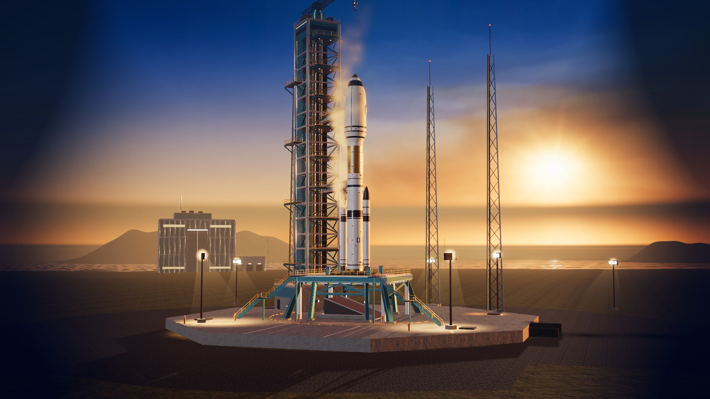
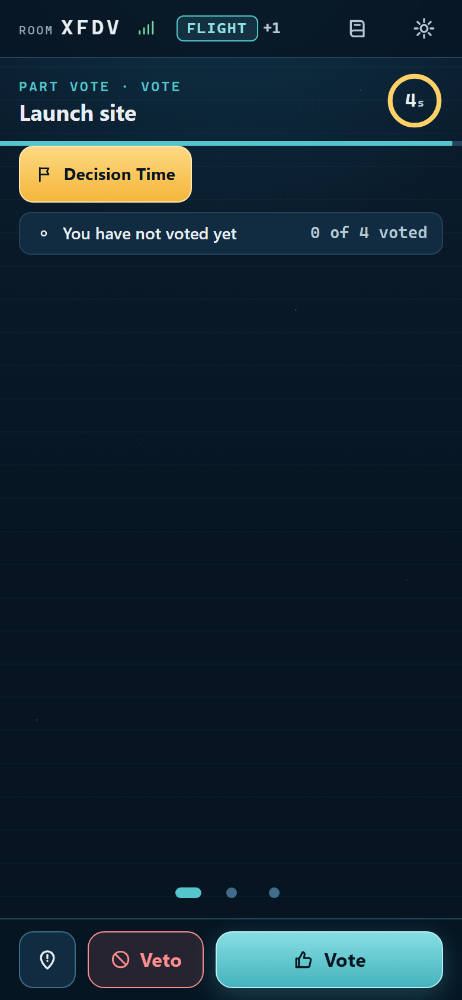
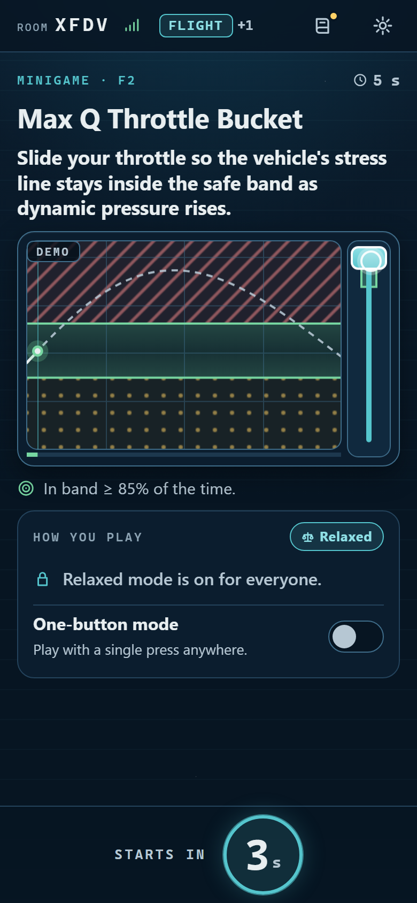

# How MissionForge works

*The full explanation of the game as built on the main branch today, for players, teachers and judges.* Part of **Team Winton**'s NASA Space Apps Challenge 2026 entry. The same text is on the web page `docs/play/guide.html` ([live](https://missionforge-spaceapps.onrender.com/play/guide.html)).

Contents: [1. What MissionForge is](#1-what-missionforge-is) · [2. Start a game](#2-start-a-game) · [3. The session flow, phase by phase](#3-the-session-flow-phase-by-phase) · [4. Roles and consoles](#4-roles-and-consoles) · [5. Voting](#5-voting) · [6. The engineering trade-offs](#6-the-engineering-trade-offs) · [7. Contracts](#7-contracts) · [8. Minigames](#8-minigames) · [9. Scoring and the debrief](#9-scoring-and-the-debrief) · [10. Accessibility and languages](#10-accessibility-and-languages) · [11. Science sources](#11-science-sources) · [12. Built versus planned](#12-built-versus-planned) · [13. Glossary](#13-glossary)

## 1. What MissionForge is

MissionForge is a cooperative party game about designing and flying a space mission. One big screen shows the rocket and the mission; every player uses their own phone as a Mission Control console. The crew votes on every part of the rocket and spacecraft under a money and schedule budget, then flies the mission together and learns the engineering trade-offs on the way.

You need **one big screen** (a laptop on a projector or TV is enough), **1 to 10 phones** with a browser, and a network that all of them can reach. Spectators can also join on their phones and watch.

- **Hosted:** open <https://missionforge-spaceapps.onrender.com/play/> on the big screen, press the host card, and have everyone open the same address (or scan the QR code on the big screen) on their phones. The free hosting server sleeps after 15 minutes without visitors, so the first visit can take about a minute. The hosted big screen was rebuilt from the main branch on 2026-11-15 (task T055); a live room has reached the debrief on a local copy of the hosted service, not yet on the public site (see **Built versus planned** for what is still unfinished).
- **Local launcher:** run `npm --prefix tools/demo install` once, then `npm --prefix tools/demo run demo`. It starts the room server on your laptop and prints an address for the phones; phones must be on the same Wi-Fi or hotspot. See `RELEASE.md`.

*The big-screen Build Bay: the rocket the crew designs, standing on the pad (from the T034 art pass).*

## 2. Start a game

1. **Host:** on the big screen open the title screen and create a mission room. The big screen creates a room and shows a **four-letter room code**, a **QR code** and a join address.
2. **Join:** each player opens the phone address (or scans the QR code), types the room code and a name, and presses Join. Up to ten players take a seat; more people can join as **spectators** (the Watch card) and are shown as an audience.
3. **Lobby settings** (host only, on the big screen; see the next table).
4. **Start the briefing** when everyone is in. The lobby says "Crew is assembling. Start the briefing when everyone is in."

| Lobby setting | Choices | What it does |
|---|---|---|
| Role assignment | Random (default), Player pick, Vote | How the ten Mission Control consoles are handed out. With fewer than ten players, one player holds several consoles. |
| Assist level | Cadet (score ×0.8) / Engineer (score ×1) / Flight Director (score ×1.25) | How much the game helps in flight. Harder levels multiply the final score. The default is Engineer. |
| Vote timer | 10, 20 (default), 30, 45 or 60 seconds | How long the voting part of each decision lasts. |
| Inspect timer | 5, 10, 20 (default), 30 or 60 seconds | How long players can read a decision's options before voting opens. |
| Audience weight | Off, or one combined ballot (default: advisory) | Whether the spectators' favourite counts as a single extra ballot. |
| Vote tallies | Open (default) or Hidden | Whether the big screen shows how many votes each option has while voting is open. |

> **Note.** The lobby settings listed here are the ones the current big-screen lobby offers. Strict-majority runoff votes exist in the room server but have no lobby control.

## 3. The session flow, phase by phase

The big screen shows the same eight steps along the top at all times: **Lobby, Briefing, Contract, Build, FRR, Countdown, Flight, Debrief**. A full session is planned at 25 to 40 minutes (a planning estimate in the project runbook, not a measured playtest figure); the length of each vote is set in the lobby.

| Phase | Big screen | Phones |
|---|---|---|
| Lobby | Room code, QR code, seats, settings, Start briefing. | Join form, then a lobby card with your seat and role. |
| Briefing and contract | The briefing film and contract card (goal, payload, orbit, budget, schedule and objectives), then a vote between the offered contracts. | Your console role card, with its private insight and ability. |
| Build (part votes) | The Build Bay: the next decision with its options, a readiness dashboard (delta-v, lift-off thrust-to-weight, total mass, cost, schedule, mission success, payload power, data budget) and the rocket being assembled. | The vote screen with a timer, a Vote button, a Veto button and your console's private hint; between votes, a build status with budget and schedule. |
| Reviews and test minigames | Design review, test stand and flight readiness review screens (see **Built vs planned**). | A GO / NO-GO poll for the crew, and build minigames such as Unit Converter Sprint or Weld Inspector when they trigger. |
| Countdown | Countdown screen. | GO / NO-GO checks and the launch-day minigames. |
| Flight | Deterministic flight simulation with a 3D view, a heads-up display, telemetry, an orbit map and minigame banners. | Your console with telemetry, plus the minigames that trigger in each flight phase. |
| Debrief | Results screen: score count-up, grade, objectives, awards, facts, timeline and replay (see **Built vs planned**). | A debrief card with the outcome and messages. |

The flight itself is split into the phases below; each can trigger console duties and minigames.

| Flight phase | Name | Consoles on duty | Minigames |
|---|---|---|---|
| F0 | Rollout & pad | FLIGHT | — |
| F1 | Propellant loading & countdown | all | MG-07, MG-08b |
| F2 | Ignition & lift-off | BOOSTER | MG-07 |
| F3 | Pitch-over & gravity turn | GUIDO, FIDO | MG-09 |
| F4 | Max Q | STRUCT | MG-08 |
| F5 | Booster sep / MECO / staging | BOOSTER, STRUCT | MG-10a, MG-11, MG-12 |
| F6 | Fairing jettison | PAYLOAD, STRUCT | MG-10 |
| F7 | Upper stage burn & orbit insertion | FIDO, GUIDO | MG-12 |
| F7b | Booster return | RETRO | MG-24 |
| F8 | Orbital operations | INCO, EECOM, PAYLOAD | MG-13, MG-14, MG-15, MG-16, MG-17, MG-18, MG-19, MG-21 |
| F9 | Deorbit burn | RETRO, FIDO | MG-20 |
| F10 | Entry interface | RETRO | MG-22, MG-26 |
| F11 | Plasma blackout & peak heating | — | MG-25 |
| F12 | Descent: drogues → mains | RETRO | MG-23, MG-17 |
| F13 | Landing / splashdown & recovery | all | MG-27 |
| F14 | Debrief | — | MG-28 |

## 4. Roles and consoles

Mission Control has ten consoles. Each gives its holder something nobody else sees (the **insight**) and one **special ability** to use once.

| Console | Private insight | One-use ability |
|---|---|---|
| **FLIGHT** — Flight Director | Sees full readiness summary & warnings first | Decision Time: Ends a stalled vote immediately; breaks ties |
| **BOOSTER** — Launch vehicle propulsion | Engine reliability ranges, throttle ranges | Hot-Fire Discount: Next engine test costs 50% less |
| **STRUCT** — Structures & materials | Dry-mass breakdown, load margins | Reinforce: +10% load margin on one stage |
| **GUIDO** — Guidance | Navigation accuracy, sensor drift | Course Correct: Halves insertion error once |
| **FIDO** — Flight dynamics | Δv requirement breakdown, orbit targets | Window Extension: +5 min launch window once |
| **EECOM** — Power, thermal & life support | Power budget, battery, thermal margins | Load Shed: Emergency power save that prevents one brownout |
| **INCO** — Communications | Data rates, ground station coverage | Priority Pass: Doubles data from one ground pass |
| **PAYLOAD** — Payload & science | Instrument performance, science value | Golden Hour: One science capture counts ×2 |
| **RETRO** — Reentry & recovery | Heat shield ratings, entry corridor | Recovery Fleet: Shrinks landing ellipse; guaranteed recovery |
| **PM** — Program manager | True cost/schedule critical path, budget forecasts | Emergency Funding: +10% budget once (costs reputation in Campaign) |

- **Pilot and co-pilot:** the phone has pilot and co-pilot screens, but the current big-screen flight runs on autopilot and does not read phone pilot input.
- **Spectators and the audience bar:** spectators join with the Watch card, see the mission as it happens and can send a preference ("Audience says") that the host can count as one ballot.
- The special abilities exist in the rules and tests, but the current big-screen host does not yet respond to the ability button (see **Built vs planned**).

## 5. Voting

Every part of the rocket is a vote. The big screen shows the options with their stats and drawbacks, and each phone casts one ballot.

1. **Reveal** (3 s): the decision appears.
2. **Inspect** (default 20 s): read the options. Your private console hint appears on your phone.
3. **Vote** (default 20 s): choose an option. A **Veto** removes one option for everyone.
4. **Result** (3 s): the winning part is bolted onto the rocket and the dashboard updates.

- **Timers:** Reveal 3 s + Inspect + Vote + Result 3 s is 46 seconds at the defaults and 21 seconds at the shortest settings, before animation or a runoff.
- **Vetoes:** each player has one veto per mission, usable on a part round during Inspect or Vote. A veto is refused if it would leave fewer than two choices.
- **Ties:** a tied vote is settled, in order, by an active Decision Time (Flight Director), then the Flight Director's own ballot if it picks one of the tied options, then a trivia answer if supplied, then a seeded coin flip.
- **Nobody votes:** the option tagged Recommended wins, otherwise the supplied default, otherwise the cheapest.
- **Audience:** with audience weight on, the spectators' favourite counts as one ballot only when they have a single favourite; a tie among the spectators adds nothing.
- **Predict step:** an optional 8-second "predict before the result" step exists in the rules but the current Build Bay does not send it.

**Reading a part card.** Each option lists its main numbers (for example thrust, specific impulse, mass, cost, and build days), a **Drawbacks** line that tells you the honest downside, a maturity label (Proven, Mature or New) that sets how uncertain the numbers are, and "If chosen" arrows that show how the choice would move cost and schedule. A **Recommended** tag marks the console's suggestion.

There are **26 part categories** with **102 part choices** in total. A contract uses a subset of them as its votes (see the contract table).

*A phone during a part vote: timer, Decision Time (Flight Director), Veto and Vote. This frame is from an automated test run with a stand-in host.*

## 6. The engineering trade-offs

A mission is decided by eight things at once. The dashboard on the big screen shows them live while the crew votes. Values in the data are tagged `physical`, `real_world_approximate` or `game_value`; the numbers behind every simplification are in the assumptions register, `GAME_DESIGN.md` section 19, and in `data/`.

| Trade-off | What the game models | What is a game simplification |
|---|---|---|
| Mass | Dry mass of every part, propellant mass and payload. More mass needs more thrust and more propellant (the rocket equation). | Part masses are rounded hardware-class values, not an exact bill of materials. |
| Delta-v and thrust | The Tsiolkovsky rocket equation for delta-v; thrust-to-weight at lift-off must exceed 1.00; staging drops empty mass. | Powered flight is stepped with a fixed time step; thrust and Isp are catalogue numbers. |
| Power | Solar arrays, batteries and loads, with eclipse handling. Payload power balance must be above zero on C1. | Power is an aggregated budget, not a circuit model. |
| Budget | Every part costs game-dollar millions; the contract sets the cap. | Costs are scaled game dollars, not real prices. |
| Schedule | Every part takes build days; the contract sets the deadline; integration and tests use slack. | Time is compressed game days. |
| Instruments | Cameras and sensors give science and data value; science targets must be captured and downlinked. | Science and data multipliers are catalogue values. |
| Orbit | A spherical Earth two-body model with analytic orbit propagation; the contract sets altitude and inclination. | No Earth oblateness (J2), one exponential atmosphere, a limited set of aerodynamic axes. |
| Communications and reliability | Data downlink in ground passes; maturity labels set an uncertainty band (about 1, 3 and 6 percent); checkpoints roll for failures with a seeded random generator. | Reliability is a probability roll at checkpoints, not component-level lifetime physics. |

## 7. Contracts

A contract is the mission the crew accepts: where to go, what to carry, how much money and time they get. All money is in game-dollar millions (M) and all schedules in compressed game days. The data stores no difficulty rating per contract (only C0 is marked as the tutorial), so none is shown here.

| ID | Contract | Goal / destination | Payload | Required delta-v | Budget | Schedule | Part votes |
|---|---|---|---|---|---|---|---|
| C0 | First Light | Suborbital, ≥100 km apogee | 0.1 t science package | 2.0 km/s | 25 M | 60 days | 19 |
| C1 | Earth Watch | Sun-synchronous orbit, 550 km, ~97.6° | 150 kg Earth-observation smallsat (designed by the team) | 9.7 km/s | 90 M | 180 days | 22 |
| C2 | Constellation Courier | LEO 500 km, 53° | 3 × 400 kg comm sats | 9.5 km/s | 120 M | 200 days | 21 |
| C3 | Station Resupply | Space station orbit, 420 km, 51.6° | 6 t cargo capsule | 9.6 km/s | 250 M | 240 days | 21 |
| C4 | Crew Flight | LEO 400 km, 3 days | 8 t crew capsule, 4 crew | 9.5 km/s | 400 M | 300 days | 23 |
| C5 | High Relay | Geostationary transfer orbit | 4 t comm sat | 11.9 km/s | 220 M | 260 days | 21 |
| C6 | Lunar Loop | Lunar flyby & return | 10 t capsule | 12.6 km/s | 700 M | 360 days | 23 |
| C7 | Red Landing | Mars surface | 1 t lander in aeroshell | 13.0 km/s | 600 M | 400 days | 20 |
| C8 | Comeback Kid | LEO 300 km | 10 t, plus booster must land | 9.4 km/s | 150 M | 200 days | 19 |

> **Note.** The nine contracts are all in the data. The big-screen Contract Vote offers a choice of contracts, but the Build Bay currently always builds **C1 Earth Watch** (another contract needs a development start option), and C1 is the only contract rehearsed end to end.

## 8. Minigames

There are **32 minigames**. Everyone plays on their phone at the same time. Each one has a **Relaxed** mode (more forgiving) and a **one-button** mode. A result is Bronze, Silver, Gold or Platinum (Platinum means every player did perfectly) and that tier decides the boost the crew earns and feeds Team Sync and the score.

| ID | Name | Triggered | What you do | Success |
|---|---|---|---|---|
| MG-01 | Unit Converter Sprint | Build, after propulsion votes (PDR). | Swipe each value to its matching SI value before it reaches the "upload" line. | ≥ 8 correct, ≤ 1 wrong. |
| MG-02 | Rocket Equation Balance | Build, after tank votes. | Drop propellant blocks on the scale to bring the Δv needle into the target band with the fewest blocks. | In band with ≤ 1 extra block. |
| MG-03 | Weld Inspector | Build, during structural material integration or static fire test. | Sweep a finger over the X-ray images of tank welds and tap the hidden porosity and cracks, avoiding false alarms. | Find ≥ 80% of defects with ≤ 1 false alarm. |
| MG-04 | Orientation Check | Build, avionics/sensor integration. | Spin each sensor and connector to match the drawing, and press "drawing error" when the drawing itself is wrong. | All correct, including catching the drawing error. |
| MG-05 | Clean Room | Build, science payload integration (or Contamination anomaly). | Wipe the drifting particles off the camera lens and mirror with gentle strokes; wiping too hard scratches. | ≥ 90% clean, no scratches. |
| MG-06 | Shake Table | Build, vibration test. | Move your damper slider to keep the resonance meter out of the red as the frequencies sweep. | Per player: their damper stays in the green ≥ 80% of the time. |
| MG-07 | Go/No-Go Poll | Countdown (F1), plus ignition. | When FLIGHT calls your console, check your 3 readings against the launch-commit limits and answer GO or NO-GO within 5 s. | Correct call in time. |
| MG-08b | Propellant Loading | F1. | Tap the valves to keep the tank fill rate in the target band while boil-off vents. | Tank ≥ 99% at T-0 without overpressure. |
| MG-08 | Max Q Throttle Bucket | F4. | Slide your throttle so the vehicle's stress line stays inside the safe band as dynamic pressure rises. | In band ≥ 85% of the time. |
| MG-09 | Gravity Turn Tracer | F3. | Trace the ideal ascent curve with a finger as the trajectory scrolls. | Average deviation below threshold. |
| MG-10a | Staging Timing | F5 (each staging event). | Tap SEPARATE in the green window just after engine cutoff, then IGNITE after the propellant settles. | Each player taps inside the window (±0.3 s). |
| MG-10 | Fairing Catch | F6 (reusable fairing only). | Steer your recovery boat to keep the net under your fairing half as it drifts down. | Your boat stays under its target ≥ 70%. |
| MG-11 | Pogo Damper | F5 (if pogo triggered, chance raised without a pogo test). | Tap in counter-rhythm to the lengthwise bouncing of the vehicle to cancel it. | Each player's taps are opposite in phase to the oscillation for ≥ 70% of beats. |
| MG-12 | Engine-Out Rebalance | F5/F7 if an engine fails in a cluster. | Adjust the throttle and gimbal of your engine to balance the thrust around the center of mass and keep the rocket straight. | Your engine keeps the net torque near zero. |
| MG-13 | Ground Station Pass | F8 (each pass). | Keep your antenna reticle on the ground station as it arcs across the horizon. | ≥ 75% lock time. |
| MG-14 | Debris Dodge | F8 (conjunction warning event). | Choose the smallest burn direction and duration that clears the collision probability threshold. | Safe miss with ≤ 1.2× the minimum Δv. |
| MG-15 | Solar Wing Deploy | F8 (satellite or capsule with deployable arrays). | Release your hinge in the order shown on the diagram, then rotate the wing to face the Sun. | Your hinge released in order + Sun-pointing ≥ 80%. |
| MG-16 | Station Docking | F8 (C3). | Line up the crosshairs with the translation thrusters while keeping your closing speed under the limit. | Contact with alignment error < 10 cm and speed < 10 cm/s. |
| MG-17 | Alarm Triage | F8 or descent (guaranteed if "Software Bug Found" was accepted). | Drag each alarm code to IGNORE, MONITOR or ACT according to the role cheat sheet. | ≥ 85% correct. |
| MG-18 | Eclipse Power Juggle | F8 (entering Earth's shadow). | Switch the spacecraft loads on and off to keep the battery above the red line through the eclipse while critical heaters stay on. | Battery stays above minimum, critical loads always on. |
| MG-19 | Scrubber Fix | F8 (crewed, life support event). | Drag your spare part into the right slot to help build an adapter that connects a square filter to a round socket. | The adapter is completed; each player who placed a correct part succeeds. |
| MG-20 | Deorbit Burn | F9. | Hold the burn button while the periapsis marker drops and release when it is inside the target band. | Periapsis inside the band. |
| MG-21 | Science Capture | F8 (C1 and other observation contracts), several times. | Frame and snap the targets as they pass under the ground track, avoiding clouds unless you chose radar. | ≥ 3 good captures. |
| MG-22 | Entry Corridor | F10. | Keep the angle icon of the capsule inside the narrow corridor: not too steep and not too shallow. | ≥ 85% of the time inside. |
| MG-23 | Parachute Sequence | F12. | Deploy your parachute exactly when its altitude/speed gate lights. | Your chute opens in its gate. |
| MG-24 | Hoverslam | F7b (booster return) or C8 landing. | Tap IGNITE at the right altitude so the velocity of the booster reaches zero exactly at the ground. | Touchdown speed < 2 m/s. |
| MG-25 | Reacquire Signal | End of F11 blackout. | Turn the tuning dial to find the beacon frequency of the capsule, then press LOCK. | Lock within 10 s. |
| MG-26 | Seven Minutes of Terror | C7 Mars entry, descent and landing. | Before entry, place your step of the landing sequence in the right order with the right timing, then watch the result arrive. | Your step is correct in order and timing. |
| MG-27 | Recovery Team | F13 splashdown. | Follow the beacon signal to the capsule and arrive in order: swimmers, flotation collar, ship. | Your unit arrives in the correct order. |
| MG-28 | Root Cause Investigation | After a failure or major anomaly (debrief). | Combine your telemetry cards with those of your teammates to build the chain of evidence that leads to the root cause. | Correct root cause identified. |
| MG-29 | Predict the Physics (bonus round) | Between phases (loading moments). | Choose your prediction before the animation plays. | Correct prediction. |
| MG-30 | Mission Patch Design (cosmetic) | After CDR. | Contribute one patch element (shape, symbol, color or motto), then vote on the final patch. | Always succeeds (participation). |

> **Note.** All minigames work on the phone. The big-screen flight currently sends the tier, Team Sync, points and facts of a result, but not its boosts, and several build-phase and conditional flight triggers are not wired end to end.

*The Max Q Throttle Bucket intro on a phone (test-run frame): drag the throttle so the stress line stays in the safe band.*

## 9. Scoring and the debrief

The mission score adds six groups of points, then multiplies by the assist level and any score boosts.

| Group | Points |
|---|---|
| Objectives | Primary 3,000 + secondary up to 1,500 + stretch 500 |
| Efficiency | Budget left up to 1,000 + schedule margin up to 500 (the fraction left times the points) |
| Safety and recovery | Crew safe 1,000 + booster recovered 500 + capsule recovered 300 |
| Science and data | Up to 1,500 |
| Teamwork | Per minigame: Bronze 60, Silver 120, Gold 200, Platinum 250; each Good Call 20 |
| Knowledge | Each correct prediction 50; each trivia tiebreak 30 |

**Multipliers:** assist level (Cadet ×0.8, Engineer ×1, Flight Director ×1.25) and score boosts from minigames, capped at ×1.5.

**Grades:** S from 9,000, A from 7,500, B from 6,000, C from 4,000, otherwise D. If the crew is lost, the grade is D whatever the score.

**Team Sync:** a meter that fills to 100 as the crew wins minigames (Gold +25, Silver +15, Bronze +8, each Good Call +3). A full meter lets the crew choose a Mission Control Moment: a perfect next flight phase, saving the mission from one catastrophic failure, or a Golden Window that doubles the next phase's score.

**Facts and awards:** the debrief shows facts collected along the way (the game has 40, each with a source) and individual awards (8 kinds, always positive, and every player gets at least one). There are also 12 achievements and a campaign layer that records progress, unlocks and an anonymous leaderboard.

> **Note.** The scoring, awards and campaign rules are implemented and unit-tested in the game core. The big-screen Debrief and Campaign Hub on the main branch are calculated by the core; the Debrief has been reached at the end of a live room session on a local copy of the hosted service (task T055); the Campaign Hub has been checked with rehearsal data only.

## 10. Accessibility and languages

- **6 languages:** English, Arabic, Spanish, French, Hindi, Portuguese. Arabic is shown right to left. Anything missing in a language falls back to English.
- **Text size:** 100, 125, 150, 175 or 200 percent on the phone.
- **Display:** high contrast and reduced motion.
- **Minigames:** a Relaxed mode and a one-button mode for every minigame, hold or toggle controls, and haptics.
- **Screen readers:** the phone uses headings, labels and live regions, and announces timers; there is a screen-reader preference in Settings.
- The big screen respects high contrast, reduced motion and right-to-left room settings, and it has a working Settings and Accessibility overlay (in the rebuilt host of 2026-11-15, but not part of its live run). At 200 percent text with right-to-left layout the Build Bay still drops or splits some text.

## 11. Science sources

MissionForge ships static content only. **No live NASA data feed or API is used.** The sources are listed in `submission/NASA_RESOURCES.md`:

- **40 facts** shown to players, each checked against a NASA or space-agency source and carrying its source link (listed with access dates on the credits page).
- **NASA imagery** used as textures in the big-screen host, with credits.
- **Engineering values** rounded from real hardware classes (parts are generic, each with a "real-world twin" line).
- **The challenge resources** (systems-engineering overview, Concept Maturity Levels, Mission Design Lab, CubeSat 101 and others) as inspiration for the phases, the maturity labels, the roles and the payload choices.

The game is not affiliated with or endorsed by NASA. See [credits and licences](docs/play/credits.html).

## 12. Built versus planned

This guide describes the game as it is on the main branch today. These parts are honestly unfinished:

| Area | State today |
|---|---|
| Hosted big screen | Rebuilt from the main branch on 2026-11-15 (task T055), with full fonts so ≈, ₂, ×, ± and ° render. A live room was played from the lobby through the briefing, contract vote, all 22 part votes, countdown and flight to the debrief with three phones, on a local copy of the hosted service; it has not yet been played through on the public site. |
| Big-screen Briefing, Contract Vote, Test Stand, Design Review, Flight Readiness Review | Working screens with live votes and polls from the room server. The briefing and contract vote showed real data in the live run above. The Build Bay does not yet open the Test Stand or Design Review by itself. In the first live run the Flight Readiness Review showed an empty panel, because the Build Bay did not yet hand it the build; a fix was added to the rebuild task afterwards. |
| Big-screen Debrief, Campaign Hub, Codex and Settings | Working screens, calculated by the core. The Debrief showed the real score at the end of the live run above; the Campaign Hub, Codex and Settings were checked with rehearsal data. |
| Minigame overlay | No screen of its own; the flight view shows a minigame banner and slows time while the phones play. |
| Contract selection | The Contract Vote offers a choice, but the Build Bay always builds C1 Earth Watch. The other eight contracts are in the data. |
| Pilot and co-pilot | The phone screens and the protocol exist; the big-screen flight flies on autopilot and ignores them. |
| Special abilities | Defined and tested in the rules; the host does not yet react to the ability button. |
| Minigame boosts | All minigames work on the phone; the host sends tier, Team Sync, points and facts but no boosts, and some triggers are not wired. |
| Predict step | In the rules, not sent by the current Build Bay. |
| Translations of the new big-screen pre-flight text | Arabic, Spanish, French, Portuguese and Hindi were added on the main branch on 2026-11-15 (task T057); they have not been checked on the big screen yet. The phone and the rest of the host are in all six languages. |

Working end to end: the lobby with QR and room code, the briefing and contract vote, the Build Bay with real part votes, vetoes and the readiness dashboard (C1), the countdown, the flight with its 3D view and telemetry, the debrief with the real score, all phone screens, the 32 phone minigames and the six languages. The big-screen part of this was shown in one live run on a local copy of the hosted service (see above), not yet in a measured playtest.

## 13. Glossary

| Term | Meaning |
|---|---|
| Delta-v (Δv) | Total change in speed a rocket can produce: its "fuel budget" for manoeuvres. |
| Isp | Specific impulse: engine efficiency in seconds; higher is better. |
| TWR | Thrust-to-weight ratio; it must exceed 1 to lift off. |
| Max Q | The moment of maximum aerodynamic pressure on the vehicle. |
| Staging | Dropping empty rocket sections. |
| Gravity turn | A gradual pitch-over that uses gravity to bend the path into orbit. |
| Apoapsis / periapsis | The highest and lowest points of an orbit. |
| LEO / SSO / GTO | Low Earth orbit, sun-synchronous orbit, geostationary transfer orbit. |
| Entry corridor | The narrow range of entry angles that avoids burning up or skipping off. |
| Blackout | Radio loss during reentry because of plasma. |
| Hoverslam | A single landing burn timed to reach zero speed at touchdown. |
| PDR / CDR / FRR | Preliminary Design Review, Critical Design Review, Flight Readiness Review. |
| Engine-out | Finishing the mission after losing an engine. |
| Pogo | Lengthwise vibration from thrust and fuel flow feeding back on each other. |
| Team Sync | The crew meter that fills with minigame success and pays for a Mission Control Moment. |
| Veto | A player's one-per-mission power to remove an option from a part vote. |

More terms are in `GAME_DESIGN.md` section 21.

---

Not affiliated with or endorsed by NASA. First generated from `data/` by `orchestration/evidence/T051/build_guide.py` (checks in `orchestration/evidence/T051/CHECKS.md`), then edited by hand (T058, T062); the web page is rendered from this file by `orchestration/evidence/T062/build_guide_html.py`.
