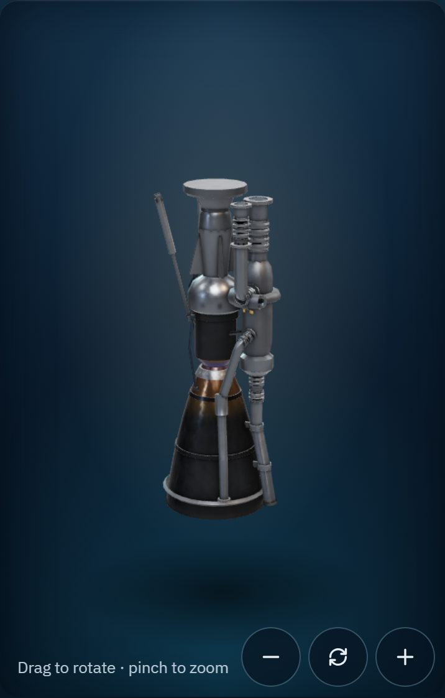

# T050 — D-102 fix: one shared WebGL renderer for the phone part viewer

Date: 2026-11-15 · Measured on base `568ee98` (PR rebased on `8c7d504`; no client/ or viewer changes in between) · Machine: Windows 11, Node 24.18, Playwright (bundled Chromium, headless)
WebGL in every run: `ANGLE (Google, Vulkan 1.3.0 (SwiftShader Device (Subzero)), SwiftShader driver)` — software GL, as in T047.

## What changed (client/src/viewer only)

| Before | After |
|---|---|
| Every `PartViewer` that became active built its own `WebGLRenderer` (new WebGL context), baked a PMREM `RoomEnvironment`, compiled its shaders, and on unmount called `renderer.dispose()` + `forceContextLoss()`. Swiping the carousel (`active` change) and every INSPECT → VOTE → RESULT remount did this again. | `threeScene.ts` owns **one** module-level `WebGLRenderer` (one context), **one** PMREM environment baked once, one light rig and camera. Each viewer owns a 2D canvas, a pivot group and a clone of the model. No `forceContextLoss` anywhere; `destroy()` removes only the viewer's own objects and canvas. |
| GLB re-parsed on every mount. | Parsed GLBs kept in an LRU cache by part id (8 entries, ref-counted; clones share geometry and materials; evicted models are disposed when their last viewer goes). |
| Active card animated; `active` change rebuilt the scene. | The animating viewer (active card, on screen per IntersectionObserver, not under the open full viewer; or the full viewer) shows the shared WebGL canvas and is drawn into directly (no pixel readback per frame). When another viewer takes the canvas over, the previous one gets its last frame copied once (`drawImage`) into its 2D canvas as a still. `active` is read through a ref: swiping keeps the scene. |
| Turntable 24 fps, drag uncapped. | Turntable 24 fps at most, cards capped at 30 fps while dragged (full viewer unchanged), and the idle turntable spaces frames at ≥ 4 × the measured frame cost (frame callback plus late next frame), so a slow device gets a slower spin instead of a busy main thread. |
| `readColors` called `getComputedStyle` on every mount (T047: 470 ms self time). | Read once per contrast mode. |

Unchanged: public props of `PartViewer` (`partId`, `size`, `active`, `onExpand`), lighting rig, ACES tone mapping/exposure, framing (FOV 30°, FILL 0.74, centre + scale to 2 units), drag/pinch/wheel/keyboard, expand to full, prefers-reduced-motion (no animation), and the 2D wireframe fallback when there is no model or no WebGL (`createThreeScene` rejects; a failed renderer creation is remembered so it is not retried per viewer). No change to `client/src/screens/vote/*`.

## Measurement

Script: [`perf-viewer.mjs`](perf-viewer.mjs) (`node ../orchestration/evidence/T050/perf-viewer.mjs --dir <dist> --label <name>` from `client/`).
It serves a built client, opens the scripted mock session `?mock=1&speed=1` on a 390 × 844 DPR 2 touch page,
throttles the CPU ×4 over CDP (`Emulation.setCPUThrottlingRate`) and runs a **fixed schedule** of 24 actions,
one every 2.5 s: swipe the carousel to the next card, and every 4th action also open the full-screen viewer for
0.9 s and close it. The session's own timers remount the cards on INSPECT → VOTE → RESULT and move on to the next
part vote during the window (stages seen in every run: INSPECT, VOTE, RESULT, build, VOTE, RESULT, build, REVEAL,
INSPECT). Long tasks come from `PerformanceObserver({type: 'longtask'})`; WebGL contexts and
`WEBGL_lose_context.loseContext()` calls are counted by wrapping `getContext`. Turntable on (no reduced motion).
"Before" is the client built from `origin/main` (`568ee98`), "after" this branch; "no-WebGL floor" is this branch with
`--disable-webgl` (every viewer is the 2D wireframe) and shows what the rest of the vote screen costs.

| Run | Swipes done / 24 actions | Full-viewer opens | WebGL contexts created | `loseContext` calls | Long tasks | Long-task total ms | Longest task ms | Tasks > 200 ms | Long-task ms per action (2.5 s window) | Longest task within 1.5 s of a stage change ms |
|---|---|---|---:|---:|---:|---:|---:|---:|---:|---:|
| before-1 | 11 | 1 | 13 | 14 | 133 | 32,492 | 1,904 | 22 | 2,209 | 1,603 |
| before-2 | 7 | 0 | 10 | 11 | 160 | 37,647 | 1,864 | 35 | 3,242 | 1,771 |
| **after-1** | 15 | 3 | **0** | **0** | 38 | 2,862 | 218 | 1 | 172 | 218 |
| **after-2** | 15 | 3 | **0** | **0** | 59 | 4,473 | 164 | 0 | 277 | 155 |
| **after-3** | 15 | 3 | **0** | **0** | 81 | 6,203 | 179 | 0 | 378 | 152 |
| no-WebGL floor | 15 | 3 | 0 | 0 | 40 | 2,729 | 163 | 0 | 167 | 142 |

(15 of 24 is the maximum: during the other 9 slots the session is on a screen without a carousel. "Before" managed
only 7–11 swipes because its clicks timed out behind the 1–2 s tasks.)

Summary, before → after (means of the runs above):

- WebGL contexts created while measuring: **11.5 → 0** (one context per page, created at the first model; page
  lifetime count after = 3, of which 2 are the harness's own probe and `hasWebGL()`'s one-time check).
- `forceContextLoss`/`loseContext` calls: **12.5 → 0**.
- Long-task total in the ~62 s window: **35.1 s → 4.5 s (−87 %)**; the no-WebGL floor is 2.7 s, so the viewer's own
  share went from ~32.4 s to ~1.8 s (**−94 %**).
- Longest task: **1,884 ms → 187 ms**; tasks over 200 ms: **28.5 → 0.3**.
- Longest task around a vote stage change: **1,687 ms → 175 ms**. Acceptance ("no long task over 200 ms from the
  viewer when a vote round changes"): met in after-2 and after-3 (152–155 ms); after-1 has **one 218 ms task** when the
  second part vote's INSPECT mounted parts not seen before (first GLB parse + first render of new materials, so most
  likely the viewer). The no-WebGL floor itself has stage-change tasks up to 142 ms. This first-sight cost per new part
  remains; revisits hit the cache.

Raw data: `runs/*.json` (every long task with its start time, the action marks, the stage-change times).
`runs/interim-*.json` are two runs of an intermediate build (shared renderer, without the cost-aware turntable
pacing; 10.7–24.8 s long-task total) and `runs/timeboxed-v0/` an earlier, time-boxed version of the script whose
workload differed per build (and whose page kept reduced motion on); both are kept for transparency only and are not
used in the table.

## Screenshots (reduced motion, unthrottled, same model angle)

| | Before | After |
|---|---|---|
| Card (first option, INSPECT) |  |  |
| Full-screen viewer |  |  |

Visually identical (same lighting, exposure, framing). The turntable path, where the viewer shows the shared WebGL
canvas directly, is in `shots/after-card-turntable.png`, `shots/after-full-turntable.png` (full viewer over the card;
the card was handed a 2D still) and `shots/after-card2-turntable.png` (after swiping to card 2: card 1 keeps its
still, card 2 owns the canvas). `shots/nogl-card.png` and `shots/nogl-full.png` show the no-WebGL fallback (2D
wireframe) on this branch. The DOM check in that run confirmed exactly one visible `viewer__gl` canvas per
viewer and the WebGL canvas moving between viewers.

## Tests and build

- `client/src/viewer/threeScene.test.ts` (new, 11 tests; three's `WebGLRenderer`, `PMREMGenerator` and `GLTFLoader`
  are faked, the rest of three is real): one context and one environment bake for 6 viewers; 5 mount/unmount rounds
  of 4 viewers never call `forceContextLoss` or `renderer.dispose`; a still is rendered and copied with the right
  rectangle; the animating viewer gets the WebGL canvas with no per-frame readback and the buffer sized once;
  hand-over leaves the previous viewer a still and a non-owner still gives the owner its frame back; context loss
  keeps the last frame and restore re-bakes the environment; cache hit, LRU eviction + re-parse, an evicted model
  in use is disposed only after its last viewer, a parse failure is not cached; no WebGL rejects (wireframe stays)
  and is not retried per viewer.
- `npx vitest run` in `client/` after rebasing on `origin/main` `8c7d504`: **48 files, 927/927 passed** (916 existing
  + 11 new). (On the older base `568ee98` the 5 `src/i18n/parity.test.ts` cases failed because #204 had added
  `data/strings/en.host_end.json` without translations; #220 fixed that upstream.)
- `npm run build` in `client/`: clean.
- `node tools/demo/build-client.mjs`: rebuilt `docs/play/client/` (same-origin `/ws`, as before).

## Not verified

- The T047 harness (`tools/e2e`, 10 phones, seed 2801, `--phone-processes shared`) was **not** re-run for this PR
  (time box); the D-102 10-phone stall numbers before/after are therefore not measured here. The single-page ×4
  measurement above is the step-1 reproduction of the brief.
- Not run on a physical phone or a hardware-GPU Chromium; all GL is SwiftShader. Absolute times are not phone
  benchmarks. On a hardware GPU the per-frame cost is far smaller, so the cost-aware pacing then stays at 24 fps.
- The first model of a page still pays one renderer creation + environment bake + shader compile (in the
  measurement this happened before the first action and was the 1,358 ms task in `runs/interim-direct-2.json`; it
  now happens once per page instead of per mount). Prewarming it before the first vote is a possible follow-up.

All numbers above are test metrics, not physical-model or game-balance values.
