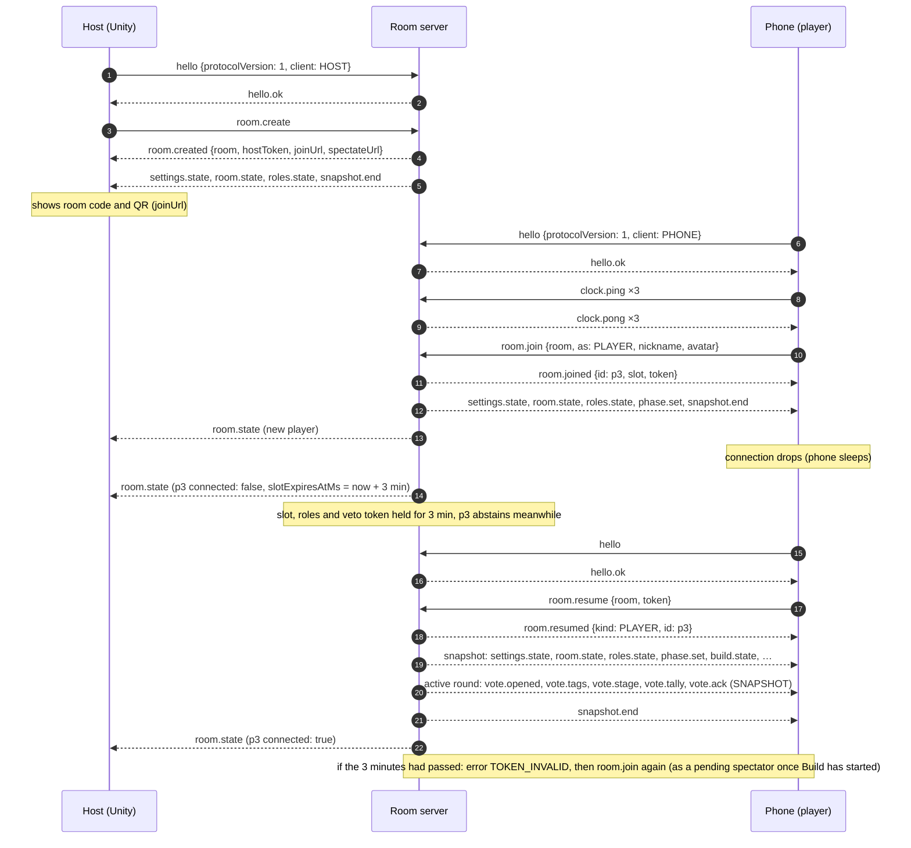
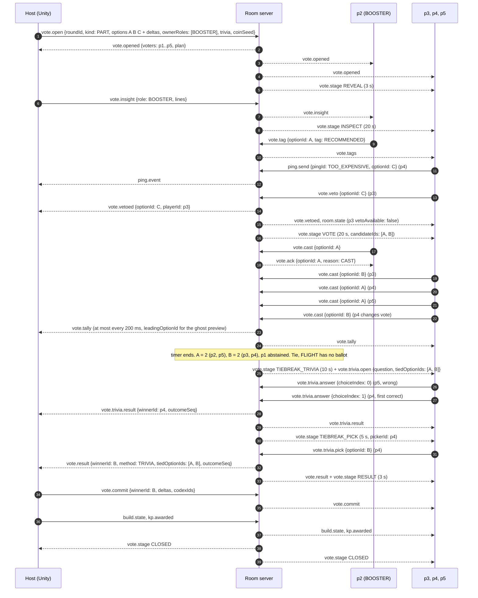
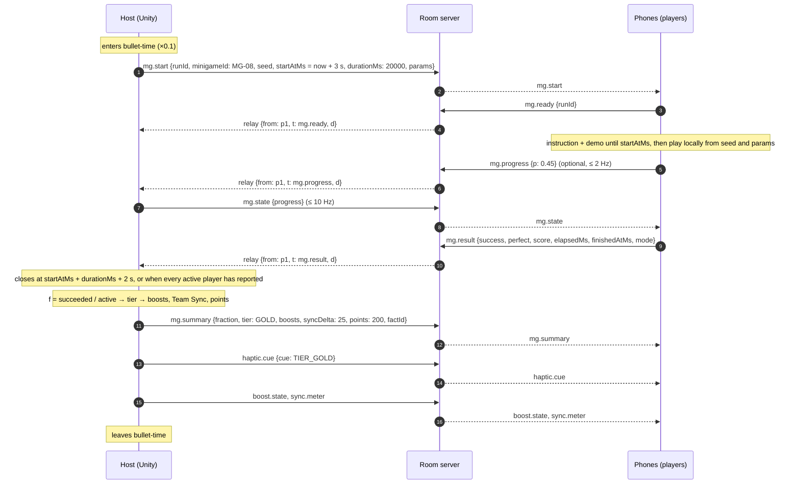
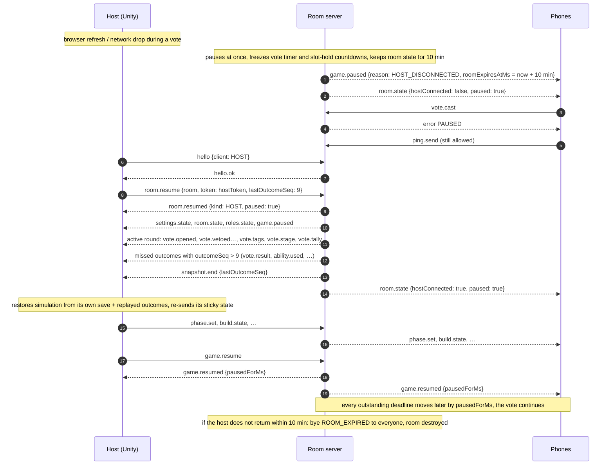

# MissionForge protocol

The contract between the Unity host, the Node room server and the phone web client.

| File | What it is | Who reads it |
|---|---|---|
| [`messages.md`](messages.md) | **Source of truth.** Every message: direction, sender, payload fields, units, server validation, the design rule it implements; plus the room, role, vote, poll, flight and minigame rules, limits, error codes and the list of decisions. | everyone |
| [`schema/<type>.schema.json`](schema/) | One JSON Schema (draft 2020-12) per message payload, plus `envelope.schema.json`. Self-contained (`$defs` inside each file), closed (`additionalProperties: false`), with examples. | server (validate incoming `d`), tests of all three parties, C# mirror in `core/Runtime/Protocol/` |
| [`ts/messages.ts`](ts/messages.ts) | TypeScript types: `Envelope`, every payload, the discriminated union `Message`, string-literal enums with their value arrays, `MESSAGE_META` (who sends, where it is delivered, sticky / droppable / pause-blocked / outcome flags). No runtime dependencies. | server and phone client (import directly) |
| [`check.mjs`](check.mjs) | Consistency check, Node 20+, no dependencies. | CI and anyone changing the protocol |

## How each party uses it

- **Room server (`server/`)** imports `ts/messages.ts`. For every incoming frame it runs the common checks of
  `messages.md` §12.1, validates `d` against `schema/<t>.schema.json` (ignoring unknown fields), then applies
  the per-message "Server validation" rules. `MESSAGE_META[t].from` is the allow-list of senders and
  `MESSAGE_META[t].to` is the routing table. The server implements vote resolution (§7.6), role rules (§5),
  timers (§7.2), the snapshot (§4.5) and the limits (§11) exactly as written.
- **Phone client (`client/`)** imports `ts/messages.ts`, sends only the types whose "Sent by" lists player or
  spectator, and renders from the broadcasts. It never recomputes simulation numbers.
- **Unity host (`unity/`, `core/`)** mirrors the payloads in C# under `core/Runtime/Protocol/` from the
  schemas (field names and enum values are identical). It sends the `host → server` and relayed
  `host → server → client` types and receives the `server → host` types, including player input wrapped in
  `relay`.

Wire format: one JSON text frame per message, `{"t": "<type>", "seq": <int>, "d": {...}}`.

## Versioning

- `hello.protocolVersion` is an integer; this is version **1** (`PROTOCOL_VERSION` in `ts/messages.ts`).
  Server and client must match exactly; otherwise the server answers `error` VERSION_MISMATCH and closes.
- **Additive changes keep the version:** a new message type, a new optional field, a new enum value.
  This works because receivers ignore unknown fields and (host and phones) unknown message types.
- **Anything else increases the version:** removing or renaming a type or field, changing a type, unit or
  meaning, making an optional field required, changing a rule in `messages.md`.
- Change `messages.md`, the schema and the TypeScript file in the same pull request as the code that needs
  the change, and run the check.

## Check

```
node protocol/check.mjs
npx -y -p typescript@5 tsc --noEmit --strict protocol/ts/messages.ts
```

`check.mjs` validates every schema's examples against its own schema (and confirms that mutated examples
are rejected), and checks that `messages.md`, `schema/` and `ts/messages.ts` list the same message types,
the same top-level fields with the same required flags, the same shared types and the same enum values.

## Sequence diagrams

### Join and reconnect



### One part vote round with a veto and a tie

Five players, options A, B, C. p1 holds FLIGHT and does not vote, so tie-breaker 1 does not apply and the
tie goes to the trivia sudden-death.



If nobody had answered the trivia correctly, the server would have skipped TIEBREAK_PICK and sent
`vote.result` with `method: COIN_FLIP` (tied options in display order, index `coinSeed mod 2`).

### A minigame round



### Host disconnect and resume


